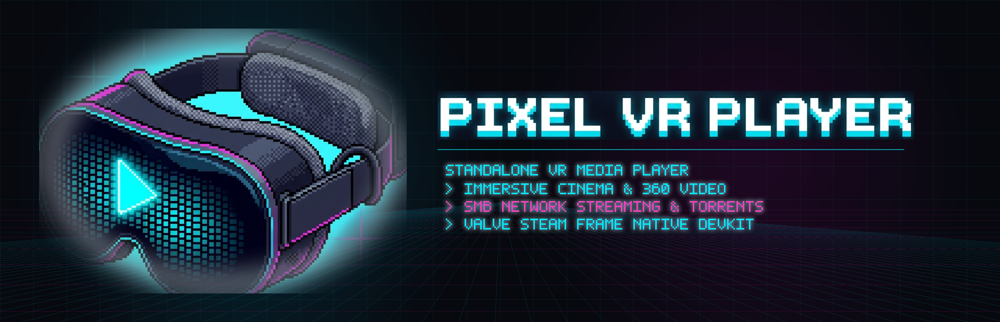

<p align="center">
  
</p>

# Pixel VR Player

A native VR video player for the **Valve Steam Frame**, playing flat 2D, 180°, and
360° video (mono and stereoscopic 3D) from local storage and the local network.

- **Platform:** SteamOS (Arch Linux, ARM64) on Snapdragon 8 Gen 3
- **Stack:** C++20 · OpenXR (SteamVR runtime) · Vulkan · FFmpeg (V4L2 M2M HW decode)
- **Targets:** native Linux `x86_64` (for SteamVR-streamed desktop dev) and
  `aarch64` (on-device, run directly on the SteamOS host)

> Status: **Feature-complete player.** OpenXR + Vulkan per-eye rendering with a
> shared depth buffer; hardware video decode (`h264_v4l2m2m` / `hevc_v4l2m2m` →
> NV12) with zero-copy dma-buf import; flat / 180° / 360° projection and mono /
> SBS (including half-SBS) / TB stereo, auto-detected from the filename; spatial
> audio with a master clock. In-headset UI: file browser (with file type and
> size), transport bar, settings menu, downloads manager, bookmarks overview,
> protected SMB network share manager with virtual keyboard laser auto-focus,
> and an encrypted hidden vault. Native Valve
> Steam Frame controller support (`XR_VALVE_frame_controller_interaction`) using
> the runtime's own render model, with per-button animation on the model and
> press-to-bind remapping.

## Screenshots

<p align="center">
  
  
</p>
<p align="center">
  
  
</p>

## Installation

Choose whichever method fits your setup:

### Option A: USB Drive / MicroSD Card (No typing & No Dev Mode needed)

The simplest method for standard users without touching the terminal:

1. Download `pixelvr-linux-arm64.tar.gz` from the [Releases](https://github.com/Pixelplanet/Pixel-VR-Player/releases) page onto a USB flash drive or MicroSD card.
2. Plug it into your Steam Frame and switch to **Desktop Mode**.
3. Open the USB drive in Dolphin and double-click **`Install Pixel VR Player.desktop`**.
4. A confirmation dialog will appear when finished. Return to Gaming Mode and launch it directly from your Steam Library!

### Option B: One command in headset terminal

If you are already in Desktop Mode on the Steam Frame, open **Konsole** and paste:

```bash
curl -fsSL https://raw.githubusercontent.com/Pixelplanet/Pixel-VR-Player/main/tools/install.sh | sh
```

*(No root access or disabled read-only filesystem needed; it installs entirely into user space).*

### Option C: From your PC over Wi-Fi (Requires SSH or Dev Mode)

If you have SSH enabled or Developer Mode turned on with your headset paired:

- **Windows:** Double-click [`tools/install-from-pc.bat`](tools/install-from-pc.bat) and enter your headset's IP.
- **macOS / Linux:** Run `./tools/install-from-pc.sh`.

The script connects over SSH, installs the app, and registers the Steam shortcut remotely.

Launch **Pixel VR Player** directly from your Steam library, or from terminal:

```bash
~/PixelVRPlayer/run.sh                 # opens the in-headset file browser
~/PixelVRPlayer/run.sh /path/clip.mp4  # …or auto-play a specific clip
```

Installer options:

| Option | Effect |
| --- | --- |
| `--dir DIR` | install somewhere other than `~/PixelVRPlayer` |
| `--version vX.Y.Z` | install a specific release instead of the latest |
| `--no-steam` | skip the Steam library entry |
| `--restart-steam` | close Steam first, then reopen it so the entry appears at once |
| `--uninstall` | remove the app and its Steam shortcut |

Re-run the same command to upgrade. Settings (`~/.config/pixelvr`), cached
thumbnails (`~/.cache/pixelvr`), and hidden vault media (`~/.pixelvr_vault`) live
outside the install directory and are kept intact.

**Offline install:** download `pixelvr-linux-arm64.tar.gz` from the
[Releases](https://github.com/Pixelplanet/Pixel-VR-Player/releases) page, copy it to the headset, extract it and run
`./install.sh` from the extracted folder — or use `run.sh` directly. The app logs
to `~/pixelvr-run.log`.

Requirements: the SteamVR OpenXR runtime (SteamOS), Vulkan, and FFmpeg with the
V4L2 M2M decoders. For zero-copy dma-buf decoding, build the patched FFmpeg into
`~/ffbuild` — `run.sh` picks it up automatically when present, otherwise it falls
back to the system FFmpeg with CPU colour conversion.


## Updating

Updating Pixel VR Player is seamless, fast, and 100% non-destructive.

> [!NOTE]
> **Your data is always preserved!**  
> All user preferences (`~/.config/pixelvr/config.json`), saved SMB network shares and credentials (`~/.config/pixelvr/smb_shares.json`), quick bookmarks (`~/.config/pixelvr/bookmarks.json`), cached video thumbnails (`~/.cache/pixelvr`), and encrypted media in the Discreet Vault (`~/.pixelvr_vault`) are stored outside the application folder and remain completely untouched across updates.

Choose your preferred update method:

### Method 1: 1-Click Desktop Update (Easiest on Headset)

No terminal or typing required:
1. Switch your Steam Frame to **Desktop Mode** (Power menu in SteamVR or SteamOS).
2. Double-click the **`Update Pixel VR Player`** icon on your Desktop.
3. A popup will notify you that the update has started. The updater verifies SHA-256 checksums and updates the app in-place.
4. When finished, a completion notification will appear. Switch back to Gaming Mode and launch the player!

*(Alternatively, open Dolphin file manager, navigate to `~/PixelVRPlayer`, and double-click `update.sh`)*.

### Method 2: 1-Click Update from your PC over Wi-Fi

Update your headset remotely over your local network:
- **Windows:** Double-click [`tools/update-from-pc.bat`](tools/update-from-pc.bat), enter your Steam Frame's IP address, and press Enter.
- **macOS / Linux:** Run `./tools/update-from-pc.sh <headset-ip>`.

### Method 3: One Command in Headset Terminal (Konsole / SSH)

Open **Konsole** on the headset or connect via SSH, then run:

```bash
~/PixelVRPlayer/update.sh
```

Or re-run the web installer command:

```bash
curl -fsSL https://raw.githubusercontent.com/Pixelplanet/Pixel-VR-Player/main/tools/install.sh | sh
```

### Method 4: USB Drive / MicroSD Card (Offline)

1. Download `pixelvr-linux-arm64.tar.gz` from the [Releases](https://github.com/Pixelplanet/Pixel-VR-Player/releases) page to a USB flash drive or MicroSD card.
2. Plug it into your Steam Frame and open it in Desktop Mode.
3. Double-click **`Install Pixel VR Player.desktop`** (or run `./install.sh --update` from the unpacked folder).


## Uninstallation

To remove Pixel VR Player and its Steam shortcut from your Steam Frame:

### From the Headset (Desktop Mode / Konsole or SSH)

Run the uninstaller script directly:

```bash
~/PixelVRPlayer/install.sh --uninstall
```

Or run the one-command uninstaller:

```bash
curl -fsSL https://raw.githubusercontent.com/Pixelplanet/Pixel-VR-Player/main/tools/install.sh | sh -s -- --uninstall
```

This cleanly removes:
* The application folder (`~/PixelVRPlayer`)
* The Non-Steam Game shortcut from Steam's library (`shortcuts.vdf`)
* All custom Steam grid artwork from `~/.steam/steam/userdata/*/config/grid/`

### From your PC over Wi-Fi

- **Windows:** Double-click [`tools/uninstall-from-pc.bat`](tools/uninstall-from-pc.bat) and enter your headset's IP.
- **macOS / Linux:** Run `./tools/uninstall-from-pc.sh`.

### Complete Data Purge (Optional)

By default, user settings (`~/.config/pixelvr`), cached video thumbnails (`~/.cache/pixelvr`), and hidden vault media (`~/.pixelvr_vault`) are kept intact so upgrading or reinstalling never loses your library state.

To completely erase all application data and settings from the headset, run:

```bash
rm -rf ~/.config/pixelvr ~/.cache/pixelvr ~/.pixelvr_vault
```


## Controls

The laser pointer and the control bar are **separate** input paths, so the bar
stays usable while a panel is open.

| Input | Action |
| --- | --- |
| **Trigger** | Point and click: open the entry under the laser, or press a control-bar button |
| **A** | Open the highlighted entry — folder navigates, video plays / streams. Outside the browser it is play / pause |
| **X** / **Y** | Download the highlighted entry (folders confirm first, showing their size) |
| **B** | Open or close the file browser; also closes a panel and cancels the download dialog |
| **Grip** | Toggle **that hand's** laser pointer on/off. Turn one off to navigate with the thumbstick or d-pad without the beam interfering, and to choose which controller points |
| Thumbstick | Move the highlight in a panel; left/right seeks while playing |
| **Bumper** | Recenter the view in front of you |

The control bar has a **Download** button (arrow) that downloads the entry
highlighted in the browser, and a **Downloads** button (list icon) that opens the
downloads manager — where you can pause, resume, stop and clear jobs, then play a
finished file or open a finished folder. Opening the downloads manager replaces
the file browser rather than stacking on top of it.

All button bindings can be changed in **Settings ▸ Controls** (press-to-bind).


## Discreet Media Vault

Pixel VR Player includes a private, zero-trace local storage vault (`~/.pixelvr_vault`) hidden from the standard file browser and startup directory scans.

<details>
<summary>🔒 <b>Accessing the Hidden Vault</b> (click to expand)</summary>

To open or re-lock the vault in VR without bringing up an on-screen keyboard or visible PIN dialog:

1. Fully squeeze either controller's **grip** (hold down the mechanical **Full Press** click).
2. While holding the grip clicked, enter the 6-key factory combination:

> 🎵 *The Swedish pop sensation that won Eurovision in 1974 with "Waterloo"...*  
> 📐 *...followed by the two classic axes of the 2D Cartesian plane.*

<details>
<summary>👉 <i>Need the direct button sequence? Click here to reveal</i></summary>

Hold **Full Grip Click** and press:
> **`A` → `B` → `B` → `A` → `X` → `Y`**  
*(Within 2.5 seconds per step. Haptic feedback confirms each input).*

</details>

- **Instant Auto-Lock:** Re-locks automatically and immediately purges in-memory textures when the headset proximity sensor detects removal, or when clicking **[ 🔒 Lock Vault ]** in the sidebar.
- **Custom Combinations:** You can record your own custom button sequence anytime in **Settings ▸ Vault & Privacy**.
- **Move to Vault:** While unlocked, local videos can be moved directly into the vault from the browser.
- **Safe Persistence:** Media inside `~/.pixelvr_vault` is never deleted when updating or uninstalling the app.

For full architecture and security details, see the [Hidden Vault Technical Specification](docs/HIDDEN_VAULT_SPEC.md).
</details>


## Repository layout

```
src/
  util/      logging, math, small helpers
  xr/        OpenXR instance/system/session, swapchains, frame loop, input
  gfx/       Vulkan device (from OpenXR), render pass, pipelines, per-eye render
  scene/     projection meshes (flat / 180 hemisphere / 360 sphere), stereo material
  media/     demux + decode, frame queue, A/V clock, audio out   (Phase 2+)
  ui/        in-VR panel: file/library browser, transport, settings  (Phase 2+)
  sources/   local FS + SMB/DLNA/HTTP media sources                 (Phase 4)
  app/       app lifecycle, config, wiring
shaders/     GLSL sources compiled to SPIR-V at build time
cmake/       toolchain + shader-compile helpers
tools/       build & deploy scripts
```

## Prerequisites (Linux build environment)

On Windows, use **WSL2 (Ubuntu 22.04+)** or a Linux container. Install:

```bash
sudo apt update
sudo apt install -y build-essential cmake ninja-build git pkg-config \
    libvulkan-dev vulkan-tools glslang-tools spirv-tools \
    libx11-dev libxrandr-dev libxxf86vm-dev mesa-common-dev libgl1-mesa-dev \
    libavcodec-dev libavformat-dev libavutil-dev libswscale-dev libswresample-dev
```

The OpenXR loader is fetched and built from source via CMake `FetchContent`, so no
system OpenXR package is required. It is built **statically** into the executable
(no `libopenxr_loader.so` to ship) and configured for the **xlib** presentation
backend only (XCB/Wayland disabled), so the `libx11`/`mesa` headers above are the
only windowing dependencies needed to build it.

> On WSL, VS Code cannot answer `sudo`'s password prompt; run apt as root instead:
> `wsl -u root -- apt-get install -y ...`.

### aarch64 cross-compilation

Two options, in order of runtime reliability:

1. **Device sysroot (recommended).** Capture the headset's own libraries so the
   binary links against the exact FFmpeg / Vulkan / X11 SONAMEs it will load:

   ```bash
   ./tools/fetch-sysroot.sh steamos@frame        # rsyncs into ./sysroot
   PIXELVR_SYSROOT="$PWD/sysroot" ./tools/build.sh --aarch64
   ```

2. **Debian/Ubuntu arm64 multiarch (quick validation).** Enable the arm64 ports
   archive and install the `:arm64` `-dev` packages, then build without a sysroot:

   ```bash
   sudo dpkg --add-architecture arm64
   # add http://ports.ubuntu.com/ubuntu-ports/ as an arm64 source, then:
   sudo apt-get update
   sudo apt-get install -y g++-aarch64-linux-gnu \
       libavcodec-dev:arm64 libavformat-dev:arm64 libavutil-dev:arm64 \
       libswscale-dev:arm64 libswresample-dev:arm64 \
       libvulkan-dev:arm64 libx11-dev:arm64 libxrandr-dev:arm64 libxxf86vm-dev:arm64
   ./tools/build.sh --aarch64
   ```

   Ubuntu's arm64 FFmpeg may differ in SONAME from the headset's; if the app
   fails to load a library on-device, use the sysroot path above. Audio
   (`libpulse-dev`) is omitted here because its glib dev chain is not
   co-installable across architectures — the sysroot build restores it.

## Build

Native (desktop, for SteamVR-streamed iteration):

```bash
./tools/build.sh            # configures + builds build/ for host arch
```

aarch64 cross (for the Steam Frame):

```bash
./tools/build.sh --aarch64  # configures + builds build-aarch64/
```

Release builds are automated: `.github/workflows/release.yml` builds natively on
an ARM64 runner in a Debian 13 container (FFmpeg 7, matching the headset's
SONAMEs) and attaches `pixelvr-linux-arm64.tar.gz` to each `v*` tag's release.
To package a local build by hand:

```bash
./tools/package-release.sh build-aarch64 pixelvr-linux-arm64.tar.gz
```

## Deploy to Steam Frame

See the full walkthrough in
[docs/deploy-to-steam-frame.md](docs/deploy-to-steam-frame.md) (options, runtime
choice, and troubleshooting). In short, after a one-time Developer-Mode pairing:

- **GUI (easiest to start):** `./tools/stage.sh` to assemble `dist/PixelVRPlayer/`,
  then upload it in the **SteamOS Devkit Client** (Runtime: *Steam Linux Runtime
  3.0 ARM64 (Sniper)*, Start Command: `pixelvr`).
- **CLI (easiest to iterate):** one command copies the binary + shaders and
  launches it in the headset:

  ```bash
  ./tools/deploy.sh --launch -- /home/steamos/Videos/clip_360_tb.mp4
  # override the target with --host steamos@<ip> or FRAME_HOST
  ```

Either way the app appears in **Steam ▸ Library ▸ Non-Steam** as **Pixel VR Player**. To run it manually over SSH for debugging:

```bash
ssh steamos@frame '~/devkit-game/PixelVRPlayer/launch.sh /path/to/video.mp4'
```

## Test on device

Projection and stereo layout are inferred from the filename, so name test clips
accordingly (or pass a plain 2D clip for flat playback):

| Filename contains        | Projection | Stereo        |
|--------------------------|------------|---------------|
| `...360...`, `_sbs`/`_lr`| 360°       | side-by-side  |
| `...180...`/`vr180`, `_tb`/`_ou` | 180° | top-bottom |
| (none)                   | flat 2D    | mono          |

Requirements and tips:

- **8-bit H.264 or HEVC** with even width/height (4:2:0). 10-bit / Main10 is not
  supported by the V4L2 M2M decoder path.
- `PIXELVR_FORCE_SW=1` forces software decode (useful for debugging).
- `PIXELVR_LOG=debug` raises log verbosity.

## License & Acknowledgements

Pixel VR Player is free and open-source software licensed under the **[MIT License](LICENSE)**.

You are welcome to clone, build, inspect, and contribute to the source code on GitHub. To support ongoing development, maintenance, and headset optimizations, Pixel VR Player will also be available on **Steam** for a small fee, offering automatic updates and out-of-the-box convenience.

For full license texts and credits for third-party libraries (OpenXR, cgltf, stb, OpenVR, FreeType, FFmpeg, PulseAudio, Samba), please see **[THIRD_PARTY_LICENSES.md](THIRD_PARTY_LICENSES.md)**.
