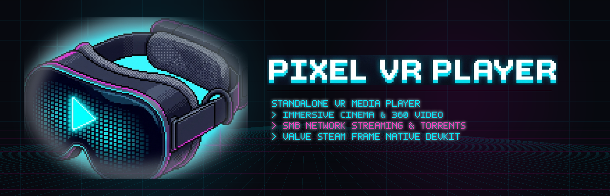
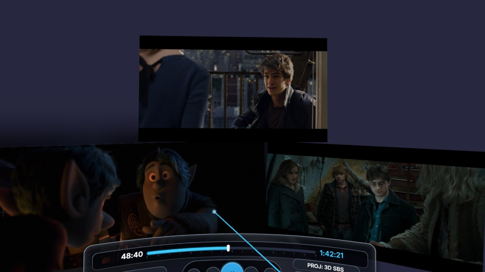
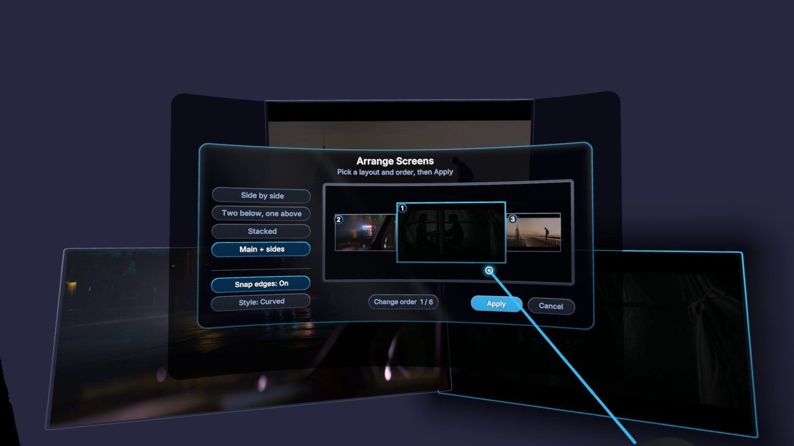
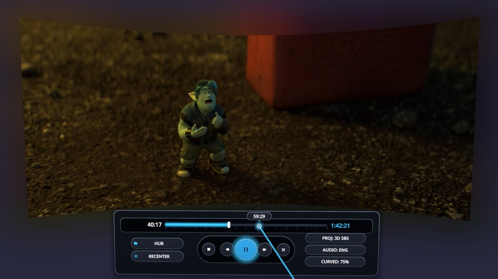
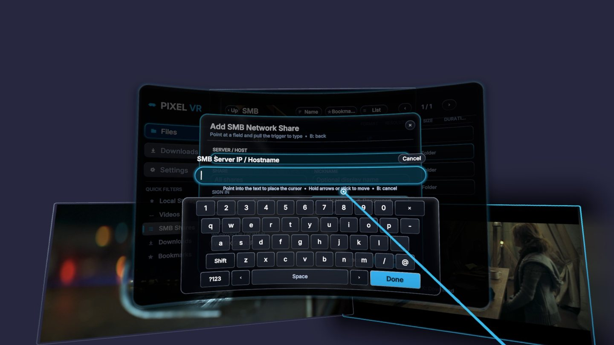

<p align="center">
  
</p>

# Pixel VR Player

A native VR video player for the **Valve Steam Frame**, playing flat 2D, 180°, and
360° video (mono and stereoscopic 3D) from local storage and the local network, plus
music, YouTube and a full web browser on floating screens.

- **Platform:** SteamOS (Arch Linux, ARM64) on Snapdragon 8 Gen 3
- **Stack:** C++20 · OpenXR (SteamVR runtime) · Vulkan · FFmpeg (V4L2 M2M HW decode)
- **Targets:** native Linux `x86_64` (for SteamVR-streamed desktop dev) and
  `aarch64` (on-device, run directly on the SteamOS host)

> Status: **Feature-complete player.** OpenXR + Vulkan per-eye rendering with a
> shared depth buffer; hardware video decode (`h264_v4l2m2m` / `hevc_v4l2m2m` →
> NV12) with zero-copy dma-buf import; flat / 180° / 360° projection and mono /
> SBS (including half-SBS) / TB stereo, auto-detected from the filename; spatial
> audio with a master clock. In-headset UI: file browser (with file type and
> size), transport bar, settings menu, downloads manager, bookmarks overview,
> protected SMB network share manager with a built-in keyboard, multi-screen
> playback (up to three videos arranged around you) with per-screen volume,
> YouTube and web browser screens, a music player with playlists, and an
> encrypted hidden vault. Native Valve
> Steam Frame controller support (`XR_VALVE_frame_controller_interaction`) using
> the runtime's own render model, with per-button animation on the model and
> press-to-bind remapping.

## Screenshots

Captured in the headset on a Steam Frame.

<p align="center">
  
  
</p>
<p align="center">
  
  
</p>

## Installation

### Quick install: one command

On the Steam Frame switch to **Desktop Mode**, open **Konsole** (or SSH into the headset),
paste this line and press Enter. On GitHub, the copy button at the top right of the box
copies it for you:

```sh
curl -fsSL https://raw.githubusercontent.com/Pixelplanet/Pixel-VR-Player/main/tools/install.sh | sh
```

It downloads the latest release, installs it into `~/PixelVRPlayer` and adds
**Pixel VR Player** to your Steam library. If it asks to restart Steam, answer **y**: that
marks it as a VR app so it opens straight into the player. No root access needed; run the
same line again to update.

Prefer not to type anything? Choose one of these:

### Option A: Straight from the headset's browser (no typing, no PC)

1. On the Steam Frame switch to **Desktop Mode** and open the web browser.
2. Go to the [latest release](https://github.com/Pixelplanet/Pixel-VR-Player/releases/latest) and download **`pixelvr-linux-arm64.tar.gz`**.
3. Open your **Downloads** folder in Dolphin and double-click the `.tar.gz` — if you're asked which app to open it with, pick **Dolphin**. It opens like a folder (there is no "Extract" step).
4. Drag the **`PixelVRPlayer`** folder onto the **Desktop** (or right-click it → **Copy**, then right-click the Desktop → **Paste**).
5. Open the `PixelVRPlayer` folder on the Desktop and double-click **`Install Pixel VR Player`** (choose *Execute* if asked).
6. Wait for the message box and click **OK**. Switch back to **Gaming Mode**: **Pixel VR Player** is in your library under *Non-Steam*.

> **Right-click in Desktop Mode = press the thumbstick down (click it).**
>
> The `PixelVRPlayer` folder on the Desktop is only the installer: the app lives in `~/PixelVRPlayer`, so you can delete the Desktop folder afterwards.
> The install log is `~/pixelvr-install.log`.

### Option B: USB Drive / MicroSD Card (No typing & No Dev Mode needed)

1. Download `pixelvr-linux-arm64.tar.gz` from the [Releases](https://github.com/Pixelplanet/Pixel-VR-Player/releases) page onto a USB flash drive or MicroSD card.
2. Plug it into your Steam Frame and switch to **Desktop Mode**.
3. Open the drive in Dolphin and double-click the `.tar.gz` (it opens like a folder), then follow steps 4–6 of Option A: drag **`PixelVRPlayer`** onto the Desktop, double-click **`Install Pixel VR Player`** there, click **OK**, and go back to Gaming Mode.

### Option C: From your PC over Wi-Fi (Requires SSH or Dev Mode)

If you have SSH enabled or Developer Mode turned on with your headset paired:

- **Windows:** Double-click [`tools/install-from-pc.bat`](tools/install-from-pc.bat) and enter your headset's IP.
- **macOS / Linux:** Run `./tools/install-from-pc.sh`.

The script connects over SSH, installs the app, and registers the Steam shortcut remotely.

Launch **Pixel VR Player** directly from your Steam library, or from terminal:

```bash
~/PixelVRPlayer/run.sh                 # opens the in-headset file browser
~/PixelVRPlayer/run.sh /path/clip.mp4  # …or auto-play a specific clip
```

Installer options:

| Option | Effect |
| --- | --- |
| `--dir DIR` | install somewhere other than `~/PixelVRPlayer` |
| `--version vX.Y.Z` | install a specific release instead of the latest |
| `--no-steam` | skip the Steam library entry |
| `--restart-steam` | close Steam first, then reopen it so the entry appears at once |
| `--uninstall` | remove the app and its Steam shortcut |

Re-run the same command to upgrade. Settings (`~/.config/pixelvr`), cached
thumbnails (`~/.cache/pixelvr`), and hidden vault media (`~/.pixelvr_vault`) live
outside the install directory and are kept intact.

**Offline install:** download `pixelvr-linux-arm64.tar.gz` from the
[Releases](https://github.com/Pixelplanet/Pixel-VR-Player/releases) page, copy it to the headset, extract it and run
`./install.sh` from the extracted folder — or use `run.sh` directly. The app logs
to `~/pixelvr-run.log`.

Requirements: the SteamVR OpenXR runtime (SteamOS), Vulkan, and FFmpeg with the
V4L2 M2M decoders. For zero-copy dma-buf decoding, build the patched FFmpeg into
`~/ffbuild` — `run.sh` picks it up automatically when present, otherwise it falls
back to the system FFmpeg with CPU colour conversion.


## Updating

> [!IMPORTANT]
> **After the November 2026 SteamOS update (build 20261103 or newer) you must install
> Pixel VR Player v1.11.0 or later.** That SteamOS update replaced the system FFmpeg 7 with
> FFmpeg 8, and every earlier release fails to start on it
> (`libavformat.so.61: cannot open shared object file`). Since v1.11.0 the player ships
> its own FFmpeg, so later SteamOS updates cannot break it this way again.

Updating Pixel VR Player is seamless, fast, and 100% non-destructive.

> [!NOTE]
> **Your data is always preserved!**  
> All user preferences (`~/.config/pixelvr/config.json`), saved SMB network shares and credentials (`~/.config/pixelvr/smb_shares.json`), quick bookmarks (`~/.config/pixelvr/bookmarks.json`), resume positions (`~/.config/pixelvr/playback_state.tsv`), cached video thumbnails (`~/.cache/pixelvr`), and encrypted media in the Discreet Vault (`~/.pixelvr_vault`) are stored outside the application folder and remain completely untouched across updates.

Choose your preferred update method:

### Method 1: 1-Click Desktop Update (Easiest on Headset)

No terminal or typing required:
1. Switch your Steam Frame to **Desktop Mode** (Power menu in SteamVR or SteamOS).
2. Double-click the **`Update Pixel VR Player`** icon on your Desktop.
3. A popup will notify you that the update has started. The updater verifies SHA-256 checksums and updates the app in-place.
4. When finished, a completion notification will appear. Switch back to Gaming Mode and launch the player!

*(Alternatively, open Dolphin file manager, navigate to `~/PixelVRPlayer`, and double-click `update.sh`)*.

### Method 2: 1-Click Update from your PC over Wi-Fi

Update your headset remotely over your local network:
- **Windows:** Double-click [`tools/update-from-pc.bat`](tools/update-from-pc.bat), enter your Steam Frame's IP address, and press Enter.
- **macOS / Linux:** Run `./tools/update-from-pc.sh <headset-ip>`.

### Method 3: One Command in Headset Terminal (Konsole / SSH)

Open **Konsole** on the headset or connect via SSH, then run:

```bash
~/PixelVRPlayer/update.sh
```

Or re-run the web installer command:

```bash
curl -fsSL https://raw.githubusercontent.com/Pixelplanet/Pixel-VR-Player/main/tools/install.sh | sh
```

### Method 4: USB Drive / MicroSD Card (Offline)

1. Download `pixelvr-linux-arm64.tar.gz` from the [Releases](https://github.com/Pixelplanet/Pixel-VR-Player/releases) page to a USB flash drive or MicroSD card.
2. Plug it into your Steam Frame and open it in Desktop Mode.
3. Open the archive, copy the `PixelVRPlayer` folder to the Desktop and double-click **`Install Pixel VR Player`** (or run `./install.sh --update` from it). It always updates `~/PixelVRPlayer`.


## Uninstallation

To remove Pixel VR Player and its Steam shortcut from your Steam Frame:

### From the Headset (Desktop Mode / Konsole or SSH)

Run the uninstaller script directly:

```bash
~/PixelVRPlayer/install.sh --uninstall
```

Or run the one-command uninstaller:

```bash
curl -fsSL https://raw.githubusercontent.com/Pixelplanet/Pixel-VR-Player/main/tools/install.sh | sh -s -- --uninstall
```

This cleanly removes:
* The application folder (`~/PixelVRPlayer`)
* The Non-Steam Game shortcut from Steam's library (`shortcuts.vdf`)
* All custom Steam grid artwork from `~/.steam/steam/userdata/*/config/grid/`

### From your PC over Wi-Fi

- **Windows:** Double-click [`tools/uninstall-from-pc.bat`](tools/uninstall-from-pc.bat) and enter your headset's IP.
- **macOS / Linux:** Run `./tools/uninstall-from-pc.sh`.

### Complete Data Purge (Optional)

By default, user settings (`~/.config/pixelvr`), cached video thumbnails (`~/.cache/pixelvr`), and hidden vault media (`~/.pixelvr_vault`) are kept intact so upgrading or reinstalling never loses your library state.

To completely erase all application data and settings from the headset, run:

```bash
rm -rf ~/.config/pixelvr ~/.cache/pixelvr ~/.pixelvr_vault
```


## Controls

The controls are SteamOS controller bindings: open **SteamVR Settings › Controllers ›
Show Binding On Controllers in VR** to see what every button does in the player, and
**Manage Controller Bindings** to change them (chords, long-press and double-press work
too). **Settings › Controls & Input › Controller Buttons** in the player lists the buttons
as they are currently bound.

Default buttons on the Steam Frame controllers:

| Button | Label | What it does |
| --- | --- | --- |
| **Trigger** | Select | Point and click; hold to drag (timeline, volume, screens) |
| **A** | Play / OK | Confirm in menus; play / pause while watching |
| **B** | Back | One step back: close a dialog, go up a folder, close the menu, hide the controls |
| **Menu** | Main Menu | Open or close the file browser and menus |
| **View** | Show / Hide UI | Show or hide the player controls |
| **Y** | Options | File actions for the highlighted entry, including Download |
| **X** | Recenter | Bring the screens and menus back in front of you |
| **Bumpers** | Previous / Next | Switch tabs in the menu; previous / next track in music |
| **D-pad** | Up / Vol +, Down / Vol −, Left / −10 s, Right / +10 s | Move the highlight in menus; volume and seeking while watching |
| **Right stick** | Scrub / Distance | Left/right scrubs through the video, up/down moves the screen nearer or farther. In 360° / 180°: up/down tilts the view, left/right zooms |
| **Left stick** | Skip / Distance | Left/right skips 30 s, up/down moves the screen. In 360° / 180°: left/right scrubs |
| **Stick click** | Show Controls | Shows or hides the labels next to the controller buttons (also in Settings › Controls & Input › Button Labels) |
| **Grip** | Laser Hand | Moves the laser to that hand |

More actions have no default button, so you can put them on chords in SteamVR: Mute,
Stop, Bookmarks, Next Screen, Previous Screen, Back 30 s, Forward 30 s, Lock Screens,
Audio Track and 3D Format.

The control bar has a **Download** button (arrow) that downloads the entry
highlighted in the browser, and a **Downloads** button (list icon) that opens the
downloads manager — where you can pause, resume, stop and clear jobs, then play a
finished file or open a finished folder. Opening the downloads manager replaces
the file browser rather than stacking on top of it.


## YouTube and the web browser

The hub's **YouTube** and **Browser** tabs open a web page on a floating screen, like
any video: pick the screen, move it, resize it, arrange it, open several.

- **Needs Chromium from Discover** (Flathub `org.chromium.Chromium`). Sites you signed
  in to in desktop Chromium are signed in here too (while desktop Chromium is closed).
- The laser is the mouse (trigger clicks, thumbstick scrolls, **B** goes back). Clicking
  a text field opens the keyboard, which types straight into the page.
- The full browser has tabs, an address bar, your Chromium bookmarks and fullscreen.
- The dock's play / pause, seek and timeline control the page's video, including a
  **LIVE** marker for livestreams.
- Video inside web pages is decoded on the CPU, so very high resolutions or several web
  videos at once can stutter.

## Music

Audio files (MP3, FLAC, M4A, OGG, Opus, WAV, ...) play with their album cover. Opening a
track queues its whole folder, with shuffle, repeat and a queue shown on the screen.


## Discreet Media Vault

Pixel VR Player includes a private, zero-trace local storage vault (`~/.pixelvr_vault`) hidden from the standard file browser and startup directory scans.

<details>
<summary>🔒 <b>Accessing the Hidden Vault</b> (click to expand)</summary>

To open or re-lock the vault in VR without bringing up an on-screen keyboard or visible PIN dialog:

1. Fully squeeze either controller's **grip** (hold down the mechanical **Full Press** click).
2. While holding the grip clicked, enter the 6-key factory combination:

> 🎵 *The Swedish pop sensation that won Eurovision in 1974 with "Waterloo"...*  
> 📐 *...followed by the two classic axes of the 2D Cartesian plane.*

<details>
<summary>👉 <i>Need the direct button sequence? Click here to reveal</i></summary>

Hold **Full Grip Click** and press:
> **`A` → `B` → `B` → `A` → `X` → `Y`**  
*(Within 2.5 seconds per step. Haptic feedback confirms each input).*

</details>

- **Instant Auto-Lock:** Re-locks automatically and immediately purges in-memory textures when the headset proximity sensor detects removal, or when clicking **[ 🔒 Lock Vault ]** in the sidebar.
- **Custom Combinations:** You can record your own custom button sequence anytime in **Settings ▸ Vault & Privacy**.
- **Move to Vault:** While unlocked, local videos can be moved directly into the vault from the browser.
- **Safe Persistence:** Media inside `~/.pixelvr_vault` is never deleted when updating or uninstalling the app.

For full architecture and security details, see the [Hidden Vault Technical Specification](docs/HIDDEN_VAULT_SPEC.md).
</details>


## Repository layout

```
src/
  util/      logging, math, small helpers
  xr/        OpenXR instance/system/session, swapchains, frame loop, input
  gfx/       Vulkan device (from OpenXR), render pass, pipelines, per-eye render
  scene/     projection meshes (flat / 180 hemisphere / 360 sphere), stereo material
  media/     demux + decode, frame queue, A/V clock, audio out   (Phase 2+)
  ui/        in-VR panel: file/library browser, transport, settings  (Phase 2+)
  sources/   local FS + SMB/DLNA/HTTP media sources                 (Phase 4)
  app/       app lifecycle, config, wiring
shaders/     GLSL sources compiled to SPIR-V at build time
cmake/       toolchain + shader-compile helpers
tools/       build & deploy scripts
```

## Prerequisites (Linux build environment)

On Windows, use **WSL2 (Ubuntu 22.04+)** or a Linux container. Install:

```bash
sudo apt update
sudo apt install -y build-essential cmake ninja-build git pkg-config \
    libvulkan-dev vulkan-tools glslang-tools spirv-tools \
    libx11-dev libxrandr-dev libxxf86vm-dev mesa-common-dev libgl1-mesa-dev \
    libavcodec-dev libavformat-dev libavutil-dev libswscale-dev libswresample-dev
```

The OpenXR loader is fetched and built from source via CMake `FetchContent`, so no
system OpenXR package is required. It is built **statically** into the executable
(no `libopenxr_loader.so` to ship) and configured for the **xlib** presentation
backend only (XCB/Wayland disabled), so the `libx11`/`mesa` headers above are the
only windowing dependencies needed to build it.

> On WSL, VS Code cannot answer `sudo`'s password prompt; run apt as root instead:
> `wsl -u root -- apt-get install -y ...`.

### aarch64 cross-compilation

Two options, in order of runtime reliability:

1. **Device sysroot (recommended).** Capture the headset's own libraries so the
   binary links against the exact FFmpeg / Vulkan / X11 SONAMEs it will load:

   ```bash
   ./tools/fetch-sysroot.sh steamos@frame        # rsyncs into ./sysroot
   PIXELVR_SYSROOT="$PWD/sysroot" ./tools/build.sh --aarch64
   ```

2. **Debian/Ubuntu arm64 multiarch (quick validation).** Enable the arm64 ports
   archive and install the `:arm64` `-dev` packages, then build without a sysroot:

   ```bash
   sudo dpkg --add-architecture arm64
   # add http://ports.ubuntu.com/ubuntu-ports/ as an arm64 source, then:
   sudo apt-get update
   sudo apt-get install -y g++-aarch64-linux-gnu \
       libavcodec-dev:arm64 libavformat-dev:arm64 libavutil-dev:arm64 \
       libswscale-dev:arm64 libswresample-dev:arm64 \
       libvulkan-dev:arm64 libx11-dev:arm64 libxrandr-dev:arm64 libxxf86vm-dev:arm64
   ./tools/build.sh --aarch64
   ```

   Ubuntu's arm64 FFmpeg may differ in SONAME from the headset's; if the app
   fails to load a library on-device, use the sysroot path above. Audio
   (`libpulse-dev`) is omitted here because its glib dev chain is not
   co-installable across architectures — the sysroot build restores it.

## Build

Native (desktop, for SteamVR-streamed iteration):

```bash
./tools/build.sh            # configures + builds build/ for host arch
```

aarch64 cross (for the Steam Frame):

```bash
./tools/build.sh --aarch64  # configures + builds build-aarch64/
```

Release builds are automated: `.github/workflows/release.yml` builds natively on
an ARM64 runner in a Debian 13 container, compiles the player against its own
FFmpeg 8.0 (`third_party/ffmpeg`, embedded into the binary so SteamOS's FFmpeg
version no longer matters) and attaches `pixelvr-linux-arm64.tar.gz` to each
`v*` tag's release.
To package a local build by hand:

```bash
./tools/package-release.sh build-aarch64 pixelvr-linux-arm64.tar.gz
```

## Deploy to Steam Frame

See the full walkthrough in
[docs/deploy-to-steam-frame.md](docs/deploy-to-steam-frame.md) (options, runtime
choice, and troubleshooting). In short, after a one-time Developer-Mode pairing:

- **GUI (easiest to start):** `./tools/stage.sh` to assemble `dist/PixelVRPlayer/`,
  then upload it in the **SteamOS Devkit Client** (Runtime: *Steam Linux Runtime
  3.0 ARM64 (Sniper)*, Start Command: `pixelvr`).
- **CLI (easiest to iterate):** one command copies the binary + shaders and
  launches it in the headset:

  ```bash
  ./tools/deploy.sh --launch -- /home/steamos/Videos/clip_360_tb.mp4
  # override the target with --host steamos@<ip> or FRAME_HOST
  ```

Either way the app appears in **Steam ▸ Library ▸ Non-Steam** as **Pixel VR Player**. To run it manually over SSH for debugging:

```bash
ssh steamos@frame '~/devkit-game/PixelVRPlayer/launch.sh /path/to/video.mp4'
```

## Test on device

Projection and stereo layout are inferred from the filename, so name test clips
accordingly (or pass a plain 2D clip for flat playback):

| Filename contains        | Projection | Stereo        |
|--------------------------|------------|---------------|
| `...360...`, `_sbs`/`_lr`| 360°       | side-by-side  |
| `...180...`/`vr180`, `_tb`/`_ou` | 180° | top-bottom |
| (none)                   | flat 2D    | mono          |

Without a hint in the name, the layout comes from the file's own 3D / VR metadata
(MKV `StereoMode`, MP4 stereo / spherical boxes) or from the picture itself (the two
halves of a 3D frame nearly match). A format chosen by hand is remembered per file,
also after renaming it.

Requirements and tips:

- **8-bit H.264, HEVC or VP9** play on the hardware decoder (4:2:0). 10-bit / Main10
  and **AV1** are decoded on the CPU (AV1 4K at 25-30 fps runs smoothly).
- `PIXELVR_FORCE_SW=1` forces software decode (useful for debugging).
- `PIXELVR_LOG=debug` raises log verbosity.

## License & Acknowledgements

Pixel VR Player is free and open-source software licensed under the **[MIT License](LICENSE)**.

You are welcome to clone, build, inspect, and contribute to the source code on GitHub. To support ongoing development, maintenance, and headset optimizations, Pixel VR Player will also be available on **Steam** for a small fee, offering automatic updates and out-of-the-box convenience.

For full license texts and credits for third-party libraries (OpenXR, cgltf, stb, OpenVR, FreeType, FFmpeg, PulseAudio, Samba), please see **[THIRD_PARTY_LICENSES.md](THIRD_PARTY_LICENSES.md)**.
