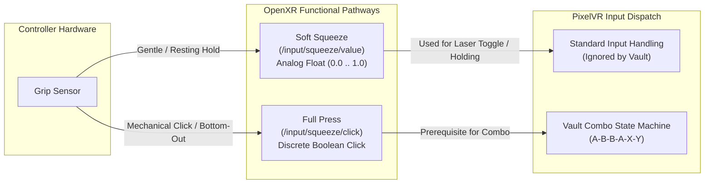

# PixelVR Hidden Vault: Technical Specification & Architecture

## 1. Overview & Core Objectives

The **Hidden Vault** provides a private, zero-trace media storage and viewing capability within PixelVR Player. It allows users to store and view sensitive or private videos without virtual keyboard input, PIN dialogs, or visible hints in the default user interface.

### Key Requirements
* **Zero Keyboard Input:** Unlocks strictly through a physical controller combination.
* **Invisible by Default:** The vault directory (`~/.pixelvr_vault/`) is excluded from all directory scans on startup and cold boot.
* **Discrete Full Press Squeeze:** Squeeze has two separate functions: *Soft Squeeze* (analog) and *Full Press* (discrete click). The combo operates **exclusively** on Full Press.
* **Re-Lock Control:** When unlocked, a dedicated `[ 🔒 Lock Vault ]` button appears in the sidebar. It is completely absent when locked.
* **Move to Vault:** Downloaded/local media can be moved into the vault when unlocked, using a button binding configured in the Vault Settings tab.
* **Strict Privacy Isolation:** Thumbnails and memory textures for vault media are purged immediately upon re-locking.

---

## 2. Discrete Grip Architecture: Soft Squeeze vs. Full Press

Modern VR controllers (Valve Frame, Valve Index, Oculus/Meta Touch) provide two separate functional signals for controller grip:

### Hardware Functional Separation
1. **Soft Squeeze (`/input/squeeze/value`):**
   * Continuous analog range ($0.0 \dots 1.0$).
   * Triggered whenever fingers rest casually on the controller or squeeze lightly.
   * **Behavior:** Completely disregarded by the Vault combo detector. A user can squeeze or hold the controller at any pressure without accidentally arming the combo.
2. **Full Press (`/input/squeeze/click` or `/input/grip/click`):**
   * Discrete boolean action representing the physical bottom-out or tactile click of the grip mechanism.
   * **Behavior:** Required as the continuous hold prerequisite for the combo state machine. The user must intentionally bottom out the grip to enter the code.

---

## 3. Unlock Sequence & Combo State Machine

### 3.1 Default Sequence
$$\text{Grip Full Press (Held)} + [\text{BtnA} \rightarrow \text{BtnB} \rightarrow \text{BtnB} \rightarrow \text{BtnA} \rightarrow \text{BtnX} \rightarrow \text{BtnY}]$$

### 3.2 State Machine Rules
* **Sliding Timeout:** 2.5 seconds between button presses. If no button is pressed within 2.5 seconds, or if the grip Full Press is released before completion, the buffer resets to empty.
* **Wrong Button Penalty:** An incorrect button immediately clears the buffer.
* **Input Interception:** While `gripFullPressHeld` is true, face button presses (`A`, `B`, `X`, `Y`) are consumed exclusively by the combo detector. They are **suppressed from normal UI actions** (play/pause, back/close, download), preventing accidental interaction with the background player while entering the code.
* **Haptic Feedback:**
  * Valid sequence step: subtle 10ms click vibration.
  * Successful Unlock / Lock: distinct 60ms double pulse.

---

## 4. UI States & Spatial Navigation

### 4.1 State: LOCKED (Default State on Launch)
* The vault directory `~/.pixelvr_vault/` is excluded from all directory enumerations in `Browser::scanLocalInto()`.
* The sidebar navigation rail contains standard entries only (`Local Storage`, `Videos`, `SMB Shares`, `Downloads`).
* The `[ 🔒 Lock Vault ]` button is completely omitted from the layout.
* The Settings menu displays standard 4 tabs (`Display`, `Controls`, `Audio`, `System`).

### 4.2 State: UNLOCKED
* **Navigation Rail:** A glowing `[ 🔒 Vault ]` shortcut appears under Library categories. Clicking it opens `~/.pixelvr_vault/` in the 3x2 media grid.
* **Re-Lock Button:** A prominent `[ 🔒 Lock Vault ]` button appears in the sidebar.
* **Settings:** A 5th tab appears: **`Vault & Privacy`**.
* **Re-locking Actions:** Clicking the lock button (or repeating the combo):
  1. Stops any currently playing video if its path is within `~/.pixelvr_vault/` and calls `renderer_.clearVideo()`.
  2. Resets the file browser immediately to `Home` (`openHome()`).
  3. Purges all in-memory thumbnail cache entries and GPU card textures for vault files.
  4. Hides the `[ 🔒 Vault ]` shortcut, `[ 🔒 Lock Vault ]` button, and the `Vault & Privacy` settings tab.

---

## 5. "Move to Vault" File Management Engine

To allow seamless transfer of downloaded videos into the vault without using desktop file managers:

1. **Availability:** The move feature is active **only when the vault is unlocked** and **only for downloaded / local files** (SMB files cannot be moved directly; they must be downloaded first).
2. **Dedicated Button Binding:** Configured inside the **Vault & Privacy** settings tab (e.g. `X`, `Y`, `Left Stick Click`, or `None`), independent of regular playback control bindings.
3. **Robust Move Implementation:**
   * Primary: `std::filesystem::rename(src, dest)`.
   * Cross-device fallback: If `rename()` fails with `EXDEV` (e.g. moving from a MicroSD card or external drive on `/run/media/...` to internal storage `~/.pixelvr_vault/`), the engine automatically performs `std::filesystem::copy_file(src, dest)` followed by `std::filesystem::remove(src)`.
4. **Collision Handling:** If `~/.pixelvr_vault/video.mp4` already exists, the destination is automatically renamed to `video_1.mp4`.
5. **Cache Eviction:** Any public preview file previously generated in `~/.cache/pixelvr/thumbnails/` for the original path is deleted immediately upon moving.

---

## 6. Dynamic "Vault & Privacy" Settings Tab

When the vault is unlocked, a 5th tab becomes available in the Settings menu:

| Setting | Options | Default | Description |
|---|---|---|---|
| **Auto-Lock on Headset Off** | `[Enabled / Disabled]` | `Enabled` | Instantly locks the vault when headset proximity/focus is lost |
| **Inactivity Auto-Lock** | `[Disabled, 2m, 5m, 10m]` | `5 min` | Automatically locks if no controller input is detected |
| **Move to Vault Button** | `[X, Y, Stick Click, None]` | `Button X` | Physical button to move focused local file to vault |
| **Custom Combo Sequence** | `[Configure / Record]` | `A B B A X Y` | Records a custom 6-button sequence |
| **Lock Vault Now** | Action Button | — | Manually locks the vault immediately |

*Settings are persisted in `~/.config/pixelvr/pixelvr.conf` under the `[vault]` section.*

---

## 7. Edge Cases & Mitigation Matrix

| Edge Case | Failure Mode / Risk | Architectural Mitigation |
|---|---|---|
| **Accidental Soft Squeeze** | Resting fingers squeeze grip slightly and start recording combo inputs. | **Hardware Function Separation:** Only the discrete `Full Press` (`squeeze/click`) arms the combo. The analog `Soft Squeeze` (`squeeze/value`) is completely ignored. |
| **Normal Button Contamination** | Pressing `A B B A X Y` pauses video or starts downloads. | Face button events are suppressed from the UI while `gripFullPressHeld` is true. |
| **Cross-Filesystem Moves** | Moving a file from a MicroSD card to internal storage fails with `EXDEV`. | Automatic fallback from `rename()` to `copy_file()` + `remove()`. |
| **Name Collisions** | Moving `clip.mp4` when `~/.pixelvr_vault/clip.mp4` already exists. | Target automatically becomes `clip_1.mp4` to prevent data loss. |
| **Thumbnail Leakage** | Public thumbnail remains in shared cache after moving video to vault. | Old public thumbnail is deleted upon move; vault previews are stored only in `~/.pixelvr_vault/.thumbs/`. |
| **Active Video on Lock** | Video from vault is playing when headset is removed or lock button is clicked. | Playback engine calls `media_.close()` and `renderer_.clearVideo()` immediately so no private frame lingers. |
| **Headset Sleep / SteamVR Menu** | User presses SteamVR system button or takes off headset. | OpenXR session state loss (`XR_SESSION_STATE_VISIBLE` or `FOCUSED` lost) triggers immediate lock and resets to Home. |
