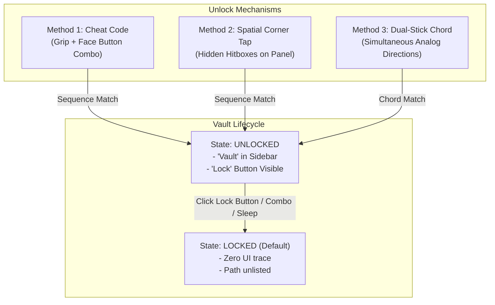

# PixelVR Hidden Vault: Architectural Concept & Design Proposals

## 1. Executive Summary & Objective

The objective is to provide a frictionless, privacy-focused **Hidden Vault** feature in PixelVR Player for confidential/private media files without requiring a virtual keyboard or password prompt. Virtual keyboard entry in VR is notoriously cumbersome, immersion-breaking, and vulnerable to "shoulder surfing" (people watching the VR mirror window on a PC or TV screen).

### Core Requirements
1. **Zero Keyboard Input:** Unlock mechanism must use physical VR controller interactions or spatial UI patterns.
2. **Locked & Hidden by Default:** On app launch and cold restart, the folder and all its contents are completely invisible and unlisted.
3. **Explicit Re-Lock Control:** Once unlocked, a visible "Lock Vault" / "Hide" button appears in the UI. When locked, this button vanishes completely.
4. **Thumbnail & Cache Privacy:** Thumbnails and metadata of private videos must never leak into shared/public system caches or stay resident in GPU memory when locked.
5. **No Clues in Default UI:** The default UI must not look like anything is missing or locked (no "Enter PIN to access Vault" prompt).

---

## 2. Comparative Analysis of Unlock Mechanisms

We have developed three distinct non-keyboard unlock concepts tailored for spatial computing, each with unique trade-offs in stealth, speed, and ergonomics.

---

### Method 1: The "Controller Cheat Code" (Grip + Button Sequence) ⭐ Recommended

*Inspired by classic gaming cheat codes (e.g., Konami Code), adapted for VR motion controllers.*

- **How It Works:**
  1. The user holds down one of the controller grips fully (e.g., **Left Grip held > 75%**).
  2. While the grip is held, the user enters a short 4-button sequence using the face buttons on either controller (e.g. `X -> Y -> B -> A` or `X -> X -> Y -> Y`).
  3. A 2.5-second sliding timeout window resets the buffer if a pause occurs or an incorrect button is pressed.
  4. On successful sequence: A subtle double-haptic vibration buzzes in the controller, and the Vault immediately unlocks.
- **Stealth Level:** **Maximum (5/5)**.
  - To anyone watching the player in real life or viewing the desktop mirror window, the player’s hands remain completely stationary. No laser beams move, no UI buttons highlight.
- **Speed & Ergonomics:** Takes **under 1 second** to perform. Natural finger resting positions on Steam Frame / Quest / Index controllers.
- **False-Positive Prevention:** Because a grip must be held continuously while a distinct button sequence is pressed, normal navigation (which uses single clicks of A, B, X, Y without holding grips) will never accidentally unlock the vault.

---

### Method 2: The "Secret UI Corner Pattern" (Spatial Easter Egg)

*Inspired by mobile OS developer-mode unlocking (e.g. tapping Android build number 7 times) and pattern locks.*

- **How It Works:**
  - The 1.8m x 1.12m Unified Spatial Hub floating panel has 4 invisible hit targets (5cm x 5cm) positioned at its four outer corners:
    - `[TL]` Top-Left
    - `[TR]` Top-Right
    - `[BR]` Bottom-Right
    - `[BL]` Bottom-Left
  - The user points the laser and clicks the trigger in a predefined sequence:
    - *Example Sequence:* `[TL] -> [TR] -> [BR] -> [TL]`.
    - *Alternative (Logo Multi-Tap):* Quadruple-clicking the "PIXEL VR" brand logo in the left navigation rail within 1.5 seconds.
- **Stealth Level:** **Moderate (3/5)**.
  - An observer watching the desktop mirror might see the laser pointer flick to the corners. However, to someone in the physical room, it looks like normal browsing.
- **Speed & Ergonomics:** Takes 2–3 seconds. Only requires one hand and the laser pointer.
- **Pros:** Very discoverable and intuitive once known; no button memorization required.

---

### Method 3: The "Dual-Stick Analog Chord" (Physical Key Turn)

*Inspired by physical safe dials.*

- **How It Works:**
  - The user deflects both thumbsticks outward simultaneously (Left Stick pushed fully Left $\leftarrow$, Right Stick pushed fully Right $\rightarrow$) and clicks both stick buttons (L3 + R3) or pulls both triggers.
- **Stealth Level:** **Maximum (5/5)**.
  - Completely invisible on screen mirrors.
- **Speed & Ergonomics:** Near-instantaneous (0.5s).
- **Cons:** Less sequence flexibility (can only be binary rather than a multi-step combination).

---

## 3. Recommended Hybrid Approach

We recommend implementing **Method 1 (Grip + Button Sequence)** as the primary unlock mechanism, with an optional fallback to **Method 2 (Logo Multi-Tap)** for maximum accessibility:

1. **Primary Combo:** Hold **Left Grip** + Press `X -> Y -> B -> A`.
2. **Alternative Laser Gesture:** 4 rapid trigger clicks on the **"PIXEL VR" Logo** in the top-left rail.
3. **Emergency Quick-Lock:** Repeating the combo from anywhere (even during full-screen video playback) immediately locks the vault and stops any private video currently playing.

---

## 4. UI Architecture & Presentation

### State 1: Locked (Default State)
- **Files View:** Only normal directories (`Videos`, `Downloads`, `SMB Shares`, external drives) appear.
- **Sidebar Rail:** Standard navigation items only (`Local Storage`, `Videos`, `SMB Shares`, `Downloads`).
- **Settings:** Zero settings or toggles referencing the vault.
- **Lock Button:** Completely absent and unrendered.

### State 2: Unlocked
- **Sidebar Rail:** A new glowing pill button appears in the sidebar library list:
  - `[ 🔒 Vault ]` (or `[ Private ]` / `[ Stash ]`).
  - Clicking this pill immediately opens the vault folder in the 3x2 card grid.
- **Action / Lock Button:** A dedicated **`[ 🔒 Lock Vault ]`** button appears in the navigation rail (either at the bottom of the sidebar or adjacent to the breadcrumbs).
- **Files Grid:** Media cards inside the vault display normal 16:9 thumbnails, format tags, and durations.

### Relocking Behavior:
When the user clicks `[ 🔒 Lock Vault ]` (or triggers the quick-lock combo):
1. If the user is currently inside the vault directory, the browser instantly navigates back to `Home` (`openHome()`).
2. If a video from the vault is currently playing, playback stops immediately and the screen resets.
3. The `[ 🔒 Vault ]` entry and `[ 🔒 Lock Vault ]` button disappear.
4. All memory buffers and GPU textures containing vault thumbnails are purged.

---

## 5. Filesystem & Privacy Architecture

### 1. Storage Location
- **Path:** `~/.pixelvr_vault/` (or `~/Videos/.vault/`).
- By utilizing a standard UNIX dotfile directory (`.pixelvr_vault`), the folder is automatically hidden from standard file managers in SteamOS Desktop Mode (Dolphin) unless "Show Hidden Files" is explicitly turned on.
- The directory will support sub-folders (e.g. `~/.pixelvr_vault/3D_VR180/`, `~/.pixelvr_vault/Movies/`).

### 2. Thumbnail Isolation & Zero-Leakage Guarantee
- **Vulnerability in Standard Caching:** Usually, thumbnail generators save image previews into a shared directory like `~/.cache/pixelvr/thumbs/` with predictable names. Anyone exploring the cache could see the private video previews.
- **The Vault Solution:**
  - Thumbnails for files located within `~/.pixelvr_vault/` are stored strictly inside `~/.pixelvr_vault/.thumbs/`.
  - When the vault is locked, all in-memory cache entries pointing to `~/.pixelvr_vault/` are evicted from the `ThumbnailCache` map, and the 6 GPU card thumbnail textures in `VulkanRenderer` are cleared to null/placeholders.

### 3. Downloads Integration
- When the vault is unlocked, downloading an SMB file can offer a quick-action: `[Download to Vault]`, allowing users to transfer files directly into the hidden folder over the network without placing them in the public `~/media` folder first.

---

## 6. Auto-Lock Safety Policies (Anti-Exposure Guards)

To protect the user from accidentally leaving their private media visible:

| Event | Action Taken |
|---|---|
| **Headset Removed** (Proximity sensor detects headset off) | **Instant Lock & Return to Home** |
| **SteamVR Dashboard Opened** (User presses system menu button) | **Instant Lock** |
| **App Minimized / Focus Lost** | **Instant Lock** |
| **Inactivity Timeout** (e.g. 5 minutes with no controller input) | **Auto-Lock & Return to Home** |
| **App Close / Restart** | **Always Cold Boots into Locked State** |

---

## 7. Configuration & Customization Options (Optional Future Settings)

Once the vault is unlocked, an advanced item can appear in the **Settings > Privacy** tab:
- **Change Unlock Combo:** Allows the user to record their own 4-step button sequence.
- **Auto-Lock Timer:** Adjust timeout (`2 min`, `5 min`, `10 min`, `Never while active`).
- **Emergency Panic Button:** Mapping a specific physical gesture (e.g., pressing both thumbsticks for 1 second) to immediately stop playback, lock vault, and switch to a decoy video or home screen.
