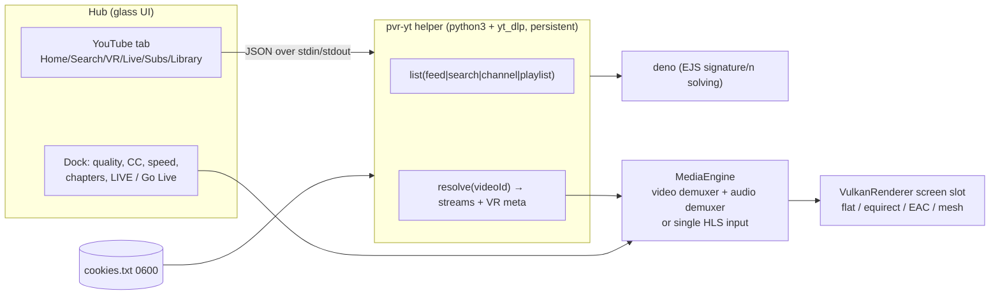

# PixelVR YouTube: Concept (browsing, floating-screen playback, live, VR formats)

> Status: **concept / for decision** — 2026-11-02. Extends the "Y. YouTube" section of
> `TODO.md` (planned 2026-11-01). Nothing here is implemented yet.
> Items marked **(verify)** are assumptions that need a spike on the Steam Frame before we
> build on them.

## 1. Goals

1. **Browse YouTube comfortably in VR**: search, home/recommended, subscriptions, live,
   channels, playlists, history and watch later. It must work with laser, thumbstick and the
   in-app keyboard.
2. **Play the chosen video on a floating screen**, the same as local files today. That
   includes multi-screen, per-screen mute, the arrange menu, and recenter.
3. **Active livestreams** work, including DVR (rewind) when the stream allows it and a
   "Go Live" jump.
4. **Our regular dock controls** work for YouTube: play/pause, seek, scrub preview, ±10 s,
   stop, format menu and track selection. We add quality, captions, speed and chapters.
5. **VR content**: 180°, 360° and 3D are detected automatically from YouTube's own metadata,
   including YouTube's cubemap/mesh projection. Manual override stays in the format menu.
6. Login is optional. Signed-in Premium users get the higher-bitrate formats and their
   personal feeds.

Non-goals: comments, posting, community tabs, Shorts swiping UX, and downloading YouTube
videos (Y0: personal use, no downloading by default).

---

## 2. Browsing: three options

The 2026-11-01 plan was **Option A** (embedded m.youtube.com). Looking at it in detail,
I now recommend **Option C**. The decision is yours, so here are all three.

### Option A — Embedded browser showing m.youtube.com (current TODO plan)
- ✅ Full YouTube feature parity, always up to date. Login is native.
- ❌ We need a web engine on aarch64 SteamOS (WPE WebKit or CEF). The root filesystem is
  read-only, so we would bundle about 100–200 MB. That is a big packaging and maintenance
  job (W1).
- ❌ **Interception is harder than it looks.** m.youtube.com is a single-page app: opening
  a video is a `history.pushState`, not a real navigation, so CEF's `OnBeforeBrowse` /
  WebKit's navigation policy never fire. We would have to inject JavaScript that hooks clicks
  and the History API, and keep it working as YouTube changes its DOM.
- ❌ The mobile site is designed for fingers at 30 cm, not a laser at 1.5 m. Tap targets are
  small, it relies on scroll-heavy feeds, and it autoplays preview videos inline. Those
  previews must be suppressed and they cost CPU/GPU while 1–3 decoders are already running.
- ❌ A browser texture that is redrawn continuously, plus its memory, competes with
  multi-screen playback.

### Option B — Native VR YouTube hub (our own glass UI, data via yt-dlp)
- ✅ Looks and behaves like the rest of the app: big cards, laser and thumbstick
  navigation, the existing `ThumbnailCache`, the in-app keyboard, and the action menu on Y.
- ✅ No web engine. yt-dlp already gives us every list we need (see §4.2), and its
  YouTube extractor already tracks YouTube's internal API changes.
- ✅ We can add **VR-first filters** that the site hides: "360°", "VR180", "3D" and "Live".
  YouTube search has native filters for 360°, VR180, 3D and Live.
- ❌ Login without a browser is the hard part (§6).
- ❌ Lists load a little slower than a browser, about 1–2 s per page. We cache and prefetch.

### Option C — Hybrid (recommended)
- **Option B for all browsing and playback.**
- A **small sign-in-only web view** (or a sign-in-from-PC fallback) used once to get account
  cookies. This is a much smaller browser problem than A: there is no interception, no feed
  ergonomics and no page video. It's just accounts.google.com, then close.
- Later, a general browser (W2) can reuse the same engine. It could also offer "Open on
  m.youtube.com" for things the hub doesn't show, such as comments.

---

## 3. User experience (Option C)

### 3.1 Where it lives
A new **YouTube** section in the hub sidebar, next to Files / Network / Bookmarks /
Downloads, with sub-tabs:

| Sub-tab | Content | Needs login |
|---|---|---|
| **Home** | Recommended feed (signed out: Trending / Explore) | no (better with) |
| **Search** | Keyboard search, recent searches, suggestions, filter chips | no |
| **VR** | Curated: 360°, VR180, 3D, "VR Live now" (search filters and VR channels) | no |
| **Live** | Live-now results, plus live channels you follow | no (better with) |
| **Subscriptions** | Latest uploads from your subscriptions; channel list | yes |
| **Library** | History, Watch later, Liked, your playlists | yes |

Opening a channel or playlist shows it in the same grid, with the breadcrumb in the header
like folders today. **Back (B)** goes up.

### 3.2 Cards
- Thumbnail (`i.ytimg.com`, cached by the existing thumbnail cache), title (2 lines),
  channel, views and age.
- Badges: **duration** or a red **● LIVE · 12K watching**; **360°**, **VR180**, **3D**;
  **Premiere / Upcoming** with a countdown.
- A watch-progress bar from YouTube history (signed in) or from our own `playback_state`.
- Same layouts as Files: BigCards / MiniCards / CompactList.

### 3.3 Opening a video
- **Trigger / A on a card** plays the video on the **selected screen**. If no screen exists,
  it opens on a new one, so the behaviour matches local files.
- **Y (action menu)**: *Play here*, *Play on new screen* (multi-screen), *Play from start*
  (live with DVR), *Quality…*, *Open channel*, *Save to Watch later*, *Copy link*
  (shown as a QR code? later).
- 180°/360° videos follow the existing rule: they always play alone. If other screens are
  open, show the existing "Play immersive (pauses other screens)?" prompt.
- An end screen offers **Up next / related** cards and an **Autoplay** toggle (default Off).

### 3.4 Search
- Opens the in-app keyboard on the panel. Live suggestions come from YouTube's suggest
  endpoint as you type.
- Filter chips: *All · Videos · Live · 360° · VR180 · 3D · Channels · Playlists*, plus
  *Duration* and *Upload date*. These map to YouTube's own search filter parameter (`sp=`).
- The last 10 searches are stored locally, with a "Clear search history" action in Settings.

### 3.5 Settings › YouTube
- Account: Sign in / Signed in as … / Sign out (clears the cookie jar and the web-view data).
- Default quality: *Auto (best hardware-decodable)* / 2160p / 1440p / 1080p / 720p.
- Prefer: *Hardware decode only* (default) / *Allow software AV1 ≤ 1080p*.
- Captions: Off / your language / auto-translated. Autoplay next: Off / On.
- yt-dlp: version and channel (stable/nightly), "Update now", and last-error log.

---

## 4. Architecture

### 4.1 `pvr-yt` helper process
- We run **yt-dlp as a Python library inside one long-lived helper**
  (`python3 pvr_yt.py`, JSON lines over stdin/stdout). The device has python3 3.12.
  Starting the PyInstaller `yt-dlp_linux_aarch64` binary for every request costs about
  1–2 s of startup each time, and browsing makes many requests. **(verify** timings on
  device)
- **A JS runtime is required now.** Since yt-dlp 2025.11, full YouTube support needs an
  external JS runtime for signature/n-parameter solving (EJS). **Deno** is the default and
  recommended one, and it has an official aarch64 Linux build. Node ≥ 22 and QuickJS-NG
  also work. We ship (or download on first use) `deno` into the app folder and pass
  `--js-runtimes deno:<path>`.
- **Updates matter.** YouTube breaks yt-dlp regularly. The helper and yt-dlp update
  **independently of app releases**: the updater checks the stable channel on launch at most
  daily, with a manual "Update now" button. A failure shows "YouTube changed something —
  updating yt-dlp…" instead of a dead screen.
- The helper caches list pages for about 5 min, and resolved streams until they are close to
  their URL expiry (the googlevideo `expire=` parameter, typically hours).

### 4.2 Data sources (all through yt-dlp, no API key, no quota)
| UI list | yt-dlp input (`extract_flat`) |
|---|---|
| Search (+filters) | `https://www.youtube.com/results?search_query=…&sp=…` |
| Home / recommended | `:ytrec` (signed in), trending/explore pages (signed out) |
| Subscriptions feed | `:ytsubs` (cookies) |
| History / Watch later / Liked | `:ythis`, `:ytwatchlater`, `:ytfav` (cookies) |
| Channel / Live tab / Playlist | channel `/videos`, `/streams`, playlist URL |

The official YouTube Data API v3 is an alternative for search and lists. However, it has a
daily quota (search is expensive), it needs an API key we would ship, and it can't play
anything. We use it only if yt-dlp listing turns out to be unreliable.

### 4.3 Client choice and PO tokens (the fragile part)
YouTube now gates stream URLs behind **PO tokens** and moves web clients to **SABR**, a
streaming protocol that FFmpeg can't play. The current state from the yt-dlp PO-Token
guide (edited 2026-07-12):
- `web` offers **SABR-only** formats, so we avoid it for playback.
- **No token needed:** `android_vr`, `tv` (needs cookies or it returns DRM formats) and
  `web_embedded` (embeddable videos only).
- `android_vr` is YouTube's own VR-app client. It's our best signed-out playback client and
  the most likely one to expose full VR180/high-res VR formats. yt-dlp maintainers say some
  VR180 formats exist *only* on the Android clients. Limitation: it has no "made for kids"
  videos and **can't take account cookies**.
- **Premium users don't need a GVS token on any client**, so signed-in Premium can use
  `tv`/`mweb` with cookies.
- **HLS live streams don't need a PO token** (except on `ios`).
- Signed-in non-Premium on `mweb` needs a PO-token provider plugin (bgutil). That's another
  moving part, so it's deferred. We fall back to `tv`+cookies.

Default client chain: signed out `android_vr` → `tv`; signed in `tv` (cookies) → `mweb`
(Premium) → `android_vr` (no cookies, for VR formats). **(verify** which client returns the
best VR formats for a sample set of 360/VR180/3D videos)

**Long-term risk:** if YouTube moves *all* clients to SABR, direct FFmpeg playback stops
working. The mitigation would be a SABR client feeding FFmpeg through custom AVIO (our SMB
read-ahead shows the pattern). Open-source SABR implementations exist that we could study,
but that would be a project of its own.

### 4.4 Stream selection (Steam Frame decoder rules)
- Hardware decode covers **VP9, H.264 and HEVC** (8-bit). **AV1 is software-only**: OK up
  to 1080p, too slow above that.
- Order: VP9 (hw) → H.264 (hw) → AV1 ≤ 1080p (sw, only if allowed) → lower resolution.
  Skip HDR (VP9.2 / 10-bit) because the V4L2 path is 8-bit.
- Consequence: many 8K 360°/VR180 videos are **AV1-only at 4320p**, so our ceiling there is
  usually the 2160p VP9 format. The quality picker shows unplayable qualities greyed out with
  "needs AV1 hardware".
- Multi-screen: the same `decoderBudgetAllows` (M5) admission check, using the format's
  width × height × fps.
- Audio: Opus/AAC stereo. For 360° videos YouTube often also has a **4-channel ambisonic**
  Opus track (spatial audio). Phase 1 picks the stereo track. Later, head-tracked
  first-order-ambisonics → binaural decoding.

### 4.5 MediaEngine changes
YouTube adaptive formats are **separate video-only and audio-only streams**. Only low
resolutions are muxed.
- **Path 1 (VOD, recommended): two demuxers, one clock.** One `AVFormatContext` for
  video and one for audio, both over HTTP. The audio clock stays the master as today. A seek
  goes to both, and each video seek still reopens the decoder.
- **Path 2 (live): one HLS input.** YouTube live HLS variants are muxed audio+video, so
  FFmpeg's HLS demuxer handles them as one input. **(verify** codecs/resolutions above 1080p
  in live HLS)
- **New `MediaSource` type** instead of `open(path)`: `{ videoUrl, audioUrl?, hlsUrl?,
  httpHeaders, cookies?, isLive, durationHint, vrMeta }`. Local files and SMB keep working
  unchanged.
- **HTTP robustness:** FFmpeg `reconnect*`, `rw_timeout`, and a read-ahead thread (same
  design as `SmbReadAhead`). Use chunked range requests (about 10 MB, like yt-dlp) to avoid
  googlevideo throttling single long reads.
- **URL expiry / 403:** on HTTP 403 the engine asks the helper to re-resolve and resumes at
  the current position. The user sees a short "Reconnecting…" spinner.
- **Buffering state:** a new `buffering()` / `bufferedAhead()` drives a spinner on the screen
  and a buffered bar on the scrubber.

---

## 5. Livestreams

| State (yt-dlp `live_status`) | Behaviour |
|---|---|
| `is_upcoming` (premiere/scheduled) | Card shows a countdown. Opening it shows a waiting slate on the screen that auto-starts at go-live. |
| `is_live` with DVR | HLS input. Scrubber shows the **DVR window**, ending in a red **LIVE** pill. |
| `is_live` without DVR / ultra-low-latency | Scrubber hidden. Pause = stop and later rejoin live. |
| `was_live` / `post_live` | Plays as VOD once YouTube has processed it (post-live may be limited to the last hours). |

**Dock behaviour while live:**
- **Play/Pause**: pause keeps the position. On resume we continue from there, still inside
  the DVR window. If we have fallen out of the window, we jump to live.
- **±10 s / scrub**: within the DVR window only. Scrub preview is off (no storyboards for
  live).
- **Go Live** button (or the LIVE pill) shows when more than 10 s behind. The pill is red at
  the live edge and grey when behind ("-2:31").
- **Speed** is disabled at the live edge.
- Viewer count and stream uptime are shown in the screen's info pill.
- "Play from start" (Y menu) uses DASH "live from start" through yt-dlp if HLS doesn't
  reach back that far. **(verify)**

360° live is supported by YouTube, and only as **equirectangular**, which keeps live VR
simpler than VOD. VR180 live existed historically; we treat it like VR180 VOD.

---

## 6. Login & Premium

Cookies are the only practical auth for yt-dlp. yt-dlp's old OAuth login for YouTube no
longer works. The app owns a private Netscape cookie jar
(`~/.config/pixelvr/youtube_cookies.txt`, 0600, optionally encrypted with the same
hardware-keyed AES-GCM as the SMB credentials).

Ways to sign in, in order of preference:
1. **In-headset sign-in web view (recommended)**: a minimal web view (W1 engine) showing
   accounts.google.com → youtube.com. On success we export its youtube.com/google.com
   cookies to the jar and close the view. **Risk (verify):** Google sometimes blocks
   sign-in from embedded/automated browsers ("This browser or app may not be secure").
   We need a test on WPE and CEF before committing to an engine.
2. **Sign in from your PC (fallback, no web engine)**: a `tools/youtube-signin-from-pc`
   script, like the install/update ones. It opens a private browser window for sign-in,
   exports cookies with yt-dlp `--cookies-from-browser`, and copies them to the headset
   over SSH. The private window avoids YouTube rotating the cookies away.
3. **Desktop mode browser on the Frame**, if the user has Firefox/Chromium installed:
   "Import from browser" button.

Notes to put in the UI: account cookies can expire or be rotated, so show "Signed out —
sign in again". yt-dlp also warns that heavy automated use of an account can get it
flagged, which is one more reason for caching and no background crawling.

---

## 7. VR & 3D formats on YouTube (research summary)

### 7.1 What creators upload
- **360°** (mono or stereo): equirectangular, with Spherical Video metadata (`sv3d`/`proj`
  in MP4, `Projection` element in WebM/MKV). Stereo 360 is **top-bottom**.
- **VR180**: 180° equirectangular, stereo **side-by-side (left-right)**.
- **3D (flat "rectangular 3D")**: YouTube's help page lists only **left-right
  side-by-side**, signalled by an `st3d` box (MP4/MOV), `StereoMode` (MKV/WebM) or H.264
  frame-packing SEI. Until processing finishes, it plays as plain SBS.
- Spherical V2 `st3d` values: 0 mono, 1 top-bottom (left on top), 2 left-right,
  3 custom (layout defined by a mesh), 4 right-left.

### 7.2 What YouTube actually *delivers* (this is where it gets tricky)
YouTube re-encodes for streaming, so the delivered layout can differ from the upload:

| Content | Typical delivered layout | How we render it |
|---|---|---|
| Flat 2D | rectangular | existing flat/curved screen |
| Flat 3D | left-right SBS (full or half width) | existing SBS / half-SBS. Decide full vs half from the frame aspect. Swap-eyes stays available for old uploads |
| 360° mono | **Equi-Angular Cubemap (EAC)** for most high-res formats; equirectangular for some formats/clients | **new EAC shader** and existing equirect sphere |
| 360° stereo | EAC with left/right eye halves, or equirect top-bottom | EAC stereo and existing TB |
| VR180 | SBS; high-res formats may be **mesh**-projected; 8K SBS reportedly only on Android VR clients | existing 180 SBS, plus mesh path |
| 360° live | equirectangular only | existing sphere |

Details:
- **EAC** (since Jan 2018): six cube faces with equal angular pixel density, in a 3×2 grid.
  Top row: left, front, right. Bottom row: down, back, up, with the bottom-row faces rotated
  (down −90°/270°, back +90°, up −90°/270°). In stereo, the left half of the frame is the
  left eye and the right half is the right eye, each a full 3×2 layout. FFmpeg's `v360`
  filter (`input=eac`) implements the same mapping and is a good reference for our
  shader's maths (we write our own; it's a few lines of trig).
- YouTube's JSON marks such formats with **`"projectionType": "MESH"`**. Others are
  `RECTANGULAR` / `EQUIRECTANGULAR` / `EQUIRECTANGULAR_THREED_TOP_BOTTOM` **(verify** the
  exact set). The stream itself carries a Spherical V2 **mesh** (`mshp`; in WebM a mesh
  `ProjectionPrivate`): vertices plus UVs per eye, deflate-compressed.
- A historical trick: requesting with an **empty user agent** returned the
  **equirectangular** encode instead of EAC for some videos. It's inconsistent, so we
  don't rely on it.
- 8K VR formats are often AV1, so they are out of hardware reach (§4.4).

### 7.3 How we detect the format (priority order)
1. **YouTube metadata** from the helper: `projectionType` / stereo layout per format.
   yt-dlp doesn't expose these fields in its format dicts, so the helper reads them from
   the player response it already fetched (a small yt-dlp hook in our own helper).
2. **Container side data**: FFmpeg's `AV_PKT_DATA_SPHERICAL` / `STEREO3D` for equirect and
   cubemap. For **mesh**, FFmpeg most likely exports no usable data **(verify)**, so we parse the init segment
   ourselves. We fetch the first ~64 KB via HTTP range and run a small EBML/ISO-BMFF parser
   for `Projection`/`sv3d`/`mshp`.
3. **Search filter / title hints** ("VR180", "3D SBS", "360") as a last resort, plus
   aspect-ratio sanity checks.
4. The **format menu override** always wins and is remembered per video ID, the same way
   per-file format memory works now.

### 7.4 Renderer work
- `ProjectionMode` gains **`EquiAngularCubemap`** and **`Mesh`**.
- **Mesh path (most general):** upload the parsed per-eye mesh as a vertex buffer and
  sample the video with its UVs. This renders EAC, VR180 mesh and any future layout exactly
  as YouTube intends.
- **EAC shader path (fallback / no mesh available):** direction → cube face → EAC
  `tan`-warp → UV in the 3×2 layout, with mono or stereo halves. A good mip/resolve setup
  matters because face seams show with poor filtering. Inset UVs by half a texel per face.
- These are immersive modes, so they always play alone (existing multi-screen rule).

---

## 8. Playback controls mapping

| Dock control | VOD | Live (DVR) | Live (no DVR) |
|---|---|---|---|
| Play / Pause | ✅ | ✅ (resume inside window) | ✅ (resume = rejoin live) |
| ±10 s, scrubber | ✅ | ✅ within window | — |
| Scrub preview | ✅ via **YouTube storyboards** (sprite sheets, instead of decoding the remote file) | — | — |
| Stop / close screen | ✅ | ✅ | ✅ |
| Format menu (projection/stereo/swap) | ✅ auto + override | ✅ | ✅ |
| Audio track (multi-language dubs) | ✅ (YouTube has multi-audio tracks) | — | — |
| **Quality** (new pill) | ✅ (switch = reopen at position) | ✅ (HLS variant) | ✅ |
| **Captions** (new) | ✅ WebVTT → text overlay below the screen | ✅ if available | — |
| **Speed** (new) | ✅ 0.5–2× | behind live only | — |
| **Chapters** (new) | ✅ ticks on timeline + chapter name | — | — |
| **LIVE / Go Live** (new) | — | ✅ | badge only |
| Resume position | ✅ our own memory per video ID (+ YouTube history when signed in) | — | — |

---

## 9. Phased plan (replaces TODO Y1–Y5 ordering)

1. **Y1 — Spikes on device (1–2 sessions).** yt-dlp + deno on the Frame: startup/RAM, the
   client matrix for a test set (flat, 3D SBS, 360 mono/stereo, VR180, 8K, live with/without
   DVR, premiere). Dump `projectionType` + init-segment mesh. Check live HLS codecs above
   1080p. Results go into TODO.md.
2. **Y2 — Play a URL natively.** `pvr-yt` helper, `MediaSource` + two-demuxer VOD path, HLS
   live path, reconnect/403 re-resolve, buffering spinner, quality selection by decoder rules.
   A temporary "Open URL" field on the keyboard.
3. **Y3 — Native YouTube hub, signed out.** Search (+filters, suggestions), VR and Live
   tabs, channel/playlist pages, cards and badges, Y-menu actions, multi-screen integration.
4. **Y4 — VR formats.** Metadata detection, EAC shader, mesh renderer, per-video format
   memory.
5. **Y5 — Live polish.** DVR scrubber, Go Live, upcoming slate, viewer count.
6. **Y6 — Login.** Engine test for Google sign-in (WPE vs CEF), sign-in web view or the PC
   fallback, cookie jar, Subscriptions/Library/Home tabs, Premium formats.
7. **Y7 — Player extras.** Captions, chapters, speed, storyboard scrub preview, Up next,
   ambisonic audio (optional).

---

## 10. Open decisions

1. **Browsing approach:** Option C (native hub + sign-in-only web view, recommended) vs
   Option A (full embedded m.youtube.com, current TODO).
2. **Login route** if Google blocks embedded sign-in: is the "sign in from PC" script
   acceptable?
3. **Steam release:** playing YouTube through yt-dlp conflicts with YouTube's Terms of Service.
   That's fine for an open-source personal build, but in a **paid Steam build** it is a
   policy/takedown risk. Options: ship it only in the GitHub build, or ship it as an optional
   user-installed add-on (the user downloads yt-dlp themselves).
4. **Spatial audio** for 360° (ambisonics → binaural): in scope for this step or later?

## Sources
- yt-dlp: external JS runtime required (EJS) — https://github.com/yt-dlp/yt-dlp/issues/15012, https://github.com/yt-dlp/yt-dlp/wiki/EJS
- yt-dlp PO-Token guide (clients, SABR, Premium, HLS live) — https://github.com/yt-dlp/yt-dlp/wiki/PO-Token-Guide
- YouTube help: Upload 3D videos — https://support.google.com/youtube/answer/7278886
- YouTube help: Encoder settings for 360° live streams — https://support.google.com/youtube/answer/6396222
- Spherical Video V2 RFC (equi / cbmp / mshp, st3d values) — https://github.com/google/spatial-media/blob/master/docs/spherical-video-v2-rfc.md
- youtube-dl #15267 (YouTube switched 360 to EAC, empty-UA trick) — https://github.com/rg3/youtube-dl/issues/15267
- yt-dlp #9903 (VR180 8K only on Android clients, `projectionType: MESH`) — https://github.com/yt-dlp/yt-dlp/issues/9903
- Paul Bourke: YouTube 360 video format (EAC face order/rotations) — https://paulbourke.net/panorama/youtubeformat/
- EAC overview and ffmpeg v360 — https://www.jiras.se/ffmpeg/equiangular.html, https://en.wikipedia.org/wiki/360_video_projection
