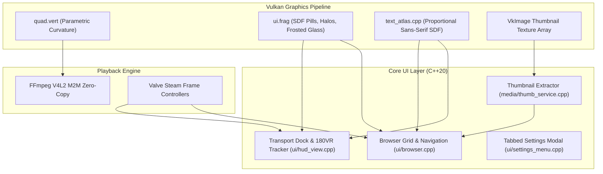
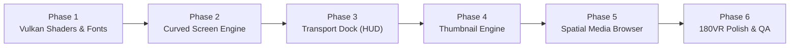

# Pixel VR Player: Implementation Plan for Modern Spatial UI

This document details the concrete implementation plan to bring **Mockup #1 (Spatial Card Media Browser)** and **Mockup #2 (Floating Cinema Transport Dock)** into Pixel VR Player, including the **Flat vs. Curved Cinema Screen** engine and **180°/360° VR contextual adaptations**, without breaking existing hardware-accelerated playback or network functionality.

---

## 1. Architectural Overview & Design Decisions

### Selected Concepts
- **File Browser:** **Concept #1 (Spatial Media Browser)** — 3x2 / 4x2 responsive card grid, 16:9 thumbnail previews, format badges (`VR180 3D`, `4K HEVC`), breadcrumb path bar, source tabs (`Local`, `SMB Shares`, `Downloads`), left navigation rail.
- **Video Controls:** **Concept #2 (Floating Transport Dock)** — Frosted glassmorphic pill dock, prominent glowing central Play/Pause hero button, wide tactile scrubber bar with buffered track & hover timestamp, quick format pill (`VR 180° SBS`), audio track pill (`ENG 5.1`), screen distance/tilt controls, and download status badge.
- **Cinema Screen:** **Parametric Flat ↔ Curved Screen Engine** — Dynamically adjustable curvature (from $0.0$ flat plane to $1.0$ IMAX-style cylindrical wrap around the viewer).
- **180° / 360° VR Adaptation:** Context-aware HUD positioning, torso/yaw "lazy follow", auto-hide fading, and 180°-specific controls (Horizon Tilt & FOV Zoom).

### Visual Mockups

#### Mockup #1: Spatial Media Browser (Card Grid & Navigation Rail)

#### Mockup #2: Floating Cinema Transport Dock (Interactive Control HUD)

#### Mockup #3: Minimalist Floating HUD Alternative

---

## 2. Flat vs. Curved Cinema Screen Engine

### 2.1 The Problem
Currently, in `shaders/quad.vert`, the flat screen is a hardcoded 6-vertex 2D planar quad (`vec2 positions[6] = ...`). It cannot curve, which leads to edge perspective stretching and focal mismatch in VR headsets when viewing large cinema screens.

### 2.2 The Curved Mesh Solution
We replace the 2-triangle flat quad with a **tessellated parametric cylindrical ribbon** (e.g. 64 horizontal subdivisions):

$$\theta(u) = (u - 0.5) \cdot \alpha_{\text{arc}}, \quad \text{where } \alpha_{\text{arc}} = \frac{W_{\text{screen}}}{R} \cdot \text{curvature}$$

$$x(u) = R \cdot \sin(\theta(u)), \quad z(u) = -R \cdot (1 - \cos(\theta(u)))$$

- **Curvature Parameter ($C \in [0.0, 1.0]$):**
  - $C = 0.0$: Perfectly flat planar screen ($z = 0$).
  - $C = 0.5$: Gentle cinema curve (subtle focal distance equalization).
  - $C = 1.0$: Immersive IMAX deep wrap (constant focal distance to the eyes across the entire field of view).
- **Aspect Ratio & Stereo Preservation:**
  - Full SBS, Half-SBS, and Top-Bottom stereo scaling remain completely intact.
  - Anamorphic widescreen formats (2.39:1, 21:9) wrap naturally around the viewer.
- **In-HUD & Settings Control:**
  - Users can toggle between **Flat** and **Curved** or adjust curvature smoothly using thumbstick left/right while pointing at the screen geometry pill.

---

## 3. 180° and 360° VR Video Adaptations

When playing VR180 or 360° videos, the video is projected onto a hemisphere/sphere around the user. The UI needs specific behavioral adaptations:

### 3.1 Lazy-Follow (Torso / Gaze Smoothing)
- **Problem:** If the HUD is locked in world space, turning around in a 180°/360° scene leaves the controls behind you. If rigidly head-locked, the controls shake with head micro-movements and induce motion sickness.
- **Solution (Torso Follow with Deadband):**
  - Allow a **$\pm 20^\circ$ yaw deadband**: Small head turns leave the HUD stationary.
  - When the user turns past $20^\circ$, the HUD smoothly glides (exponential damping, $\tau = 0.35\text{s}$) to catch up with their forward orientation.
  - Positioned $15^\circ$ below horizontal eye-level so it never blocks the primary focal center of the 180VR scene.

### 3.2 Auto-Fade Immersion Timer
- During active 180VR/360VR playback, the HUD automatically fades out after **3.5 seconds** of inactivity.
- Woken up instantly by:
  - Moving the controller (velocity threshold).
  - Touching the thumbstick or trigger.
  - Looking downward toward the dock position.

### 3.3 Dynamic Context Controls
In Flat/Cinema mode, the controls adjust *Screen Distance* and *Screen Curvature*. In 180VR/360VR, these concepts do not exist. The controls dynamically adapt:

| Feature | Cinema / Flat Mode | 180° / 360° VR Mode |
| :--- | :--- | :--- |
| **Geometry Pill** | `[ Flat / Curved Screen ]` | `[ Horizon Level / FOV ]` |
| **Thumbstick Up/Down** | Screen Distance (1.5m – 7.0m) | Horizon Pitch Tilt (`spherePitch_`) |
| **Thumbstick Left/Right** | Screen Curvature (0% – 100%) | FOV Zoom / IPD scale (`sphereZoom_`) |
| **Bumper Action** | Recenter Screen to view line | Recenter 180° Longitude to view line |
| **Comfort Depth** | Positioned just below bottom bezel | Floats at 1.8m depth, angled 18° up toward eyes |

---

## 4. Step-by-Step Implementation Roadmap

### Phase 1: Vulkan Shaders & Proportional Font Engine
*Goal: Provide the visual primitives for modern UI without touching playback logic.*
1. **Shader Primitives (`shaders/ui.frag`):**
   - Add new SDF shape types:
     - `UiShape::Pill` (stadium shape for badges and buttons).
     - `UiShape::GlowRing` (for hero play/pause button active halo).
     - `UiShape::GradientCard` (smooth two-stop vertical gradient for cards).
   - Add frosted glass background tinting with antialiased borders.
2. **Proportional Font Engine (`src/gfx/text_atlas.cpp`):**
   - Update `buildFontAtlas` to support proportional fonts (`Inter-Regular.ttf` / `Roboto-Medium.ttf`).
   - Store proportional advance and bearing metrics in `Glyph` struct.
   - Maintain ASCII & common Unicode symbol support (`✓`, `‹`, `›`, `✕`, `●`, `★`).

### Phase 2: Parametric Curved Screen Engine
*Goal: Support seamless switching between flat cinema screen and curved cinema screen.*
1. **Curvature Geometry in `vulkan_renderer.cpp`:**
   - Create a static index/vertex buffer for a 64x1 tessellated ribbon or evaluate parametric cylindrical curvature in `quad.vert`.
   - Pass `screenCurvature` ($0.0 \dots 1.0$) through the vertex push constants.
2. **Raycasting Update:**
   - When raycasting against the curved screen (for direct laser pointer scrub), intersect ray with cylinder $(x^2 + z^2 = R^2)$.

### Phase 3: Modern Floating Transport Dock (Mockup #2)
*Goal: Implement the sleek, intuitive playback dock.*
1. **Dock Layout Architecture:**
   - Left section: Download status badge & duration readout.
   - Center section: Hero Play/Pause button ($\varnothing 68\text{mm}$) + Seek -10s / +10s + tactile scrubber.
   - Right section: Format Pill (`VR 180° SBS`), Audio Pill (`ENG 5.1`), Geometry Pill (`Flat/Curved` or `Horizon/FOV`).
2. **180VR Lazy Follow & Auto-Hide:**
   - Integrate yaw deadband tracking and alpha fade timer into `src/app/app.cpp` and `vulkan_renderer.cpp`.
   - Smooth alpha transition ($0.0 \to 1.0$ in 150ms).

### Phase 4: Thumbnail Extraction & Caching Engine
*Goal: Enable visual preview cards in the browser without UI thread stalls.*
1. **Lightweight Extractor (`src/media/thumbnail_service.cpp`):**
   - Background worker thread with queue.
   - For local and downloaded files: reads first keyframe at $t \approx 10\%$ using `avformat_open_input` + `avcodec_receive_frame`.
   - Rescales to 256x144 RGBA thumbnail.
   - Caches to `~/.cache/pixelvr/thumbs/<hash>.bin`.
2. **Vulkan Texture Pool:**
   - Allocate a `VkImage` 2D Texture Array (e.g. 16–32 slots) for currently visible browser cards.
   - Stream loaded thumbnails into the array descriptors.

### Phase 5: Spatial Media Browser (Mockup #1)
*Goal: Implement the 3D curved card grid file browser.*
1. **Browser Layout Tree:**
   - Left Navigation Rail (Home, Videos, SMB Shares, Downloads).
   - Top Header (Breadcrumb trail, Source tabs, View toggle).
   - 3x2 Grid of Media Cards:
     - 16:9 Thumbnail quad.
     - Title string with proportional font.
     - Format pill badges (`VR180 3D`, `4K HEVC`).
     - Duration pill (`32:45`).
2. **Input & Pointer Physics:**
   - 2D grid raycasting: maps hit point directly to `(col, row)`.
   - Magnetic snap: gentle suction on laser ray when near card center.
   - Smooth thumbstick grid navigation (Up/Down/Left/Right).

### Phase 6: System Verification & Rigorous QA
*Goal: Ensure zero regressions across both desktop and ARM64 hardware.*
1. **Hardware Validation:**
   - Cross-compile for aarch64 Steam Frame.
   - Verify 90 Hz / 120 Hz render loop budget with Vulkan pipeline timers.
   - Confirm zero-copy DMA-BUF hardware decode remains unaffected.
2. **Functional Validation:**
   - SMB network streaming and background downloading.
   - Multi-audio stream switching and eye swapping.
   - Controller button remapping.

---

## 5. Non-Breaking Safety Guarantees

1. **Zero External Heavy Dependencies:** No Qt, no WebViews, no massive libraries. Everything builds with existing CMake toolchain and Vulkan/OpenXR/FreeType/FFmpeg stack.
2. **Graceful Fallback:** If thumbnails are not yet extracted or unavailable (e.g. slow SMB network share), the browser instantly displays clean stylized gradient placeholder cards with format icons.
3. **Model Separation:** `Browser` and `SettingsMenu` remain headless data models. All new visual enhancements live purely in the presentation/renderer layer.
