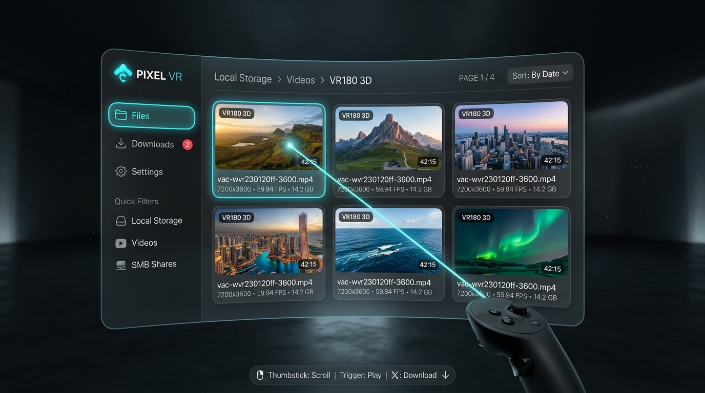
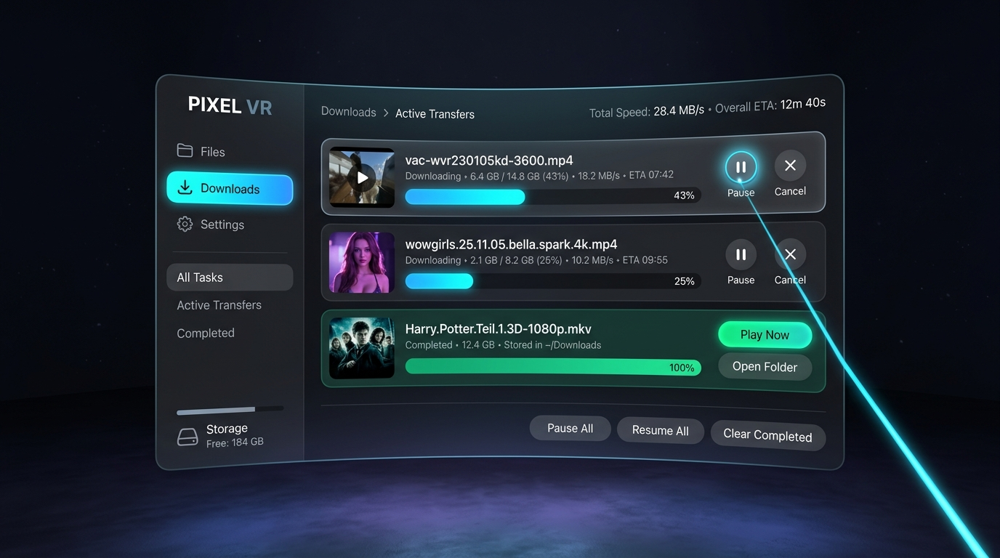
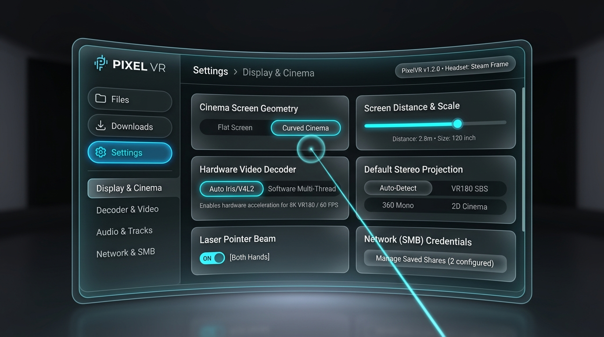
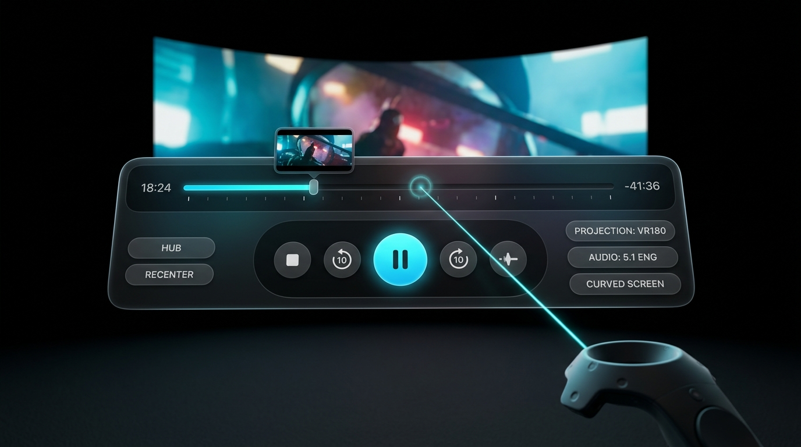

# PixelVR Unified Spatial Hub Architecture & UI Redesign Specification

## 1. Executive Summary & Design Paradigm Shift

### The Problem With Separate Overlays
In previous iterations, the VR player utilized three disconnected overlay windows with distinct dimensional footprints and conflicting layout logic:
1. **File Browser:** A 3x2 card grid with an ad-hoc left sidebar.
2. **Downloads Window:** A smaller centered modal with custom progress rows.
3. **Settings Overlay:** A tall vertical list that occluded the screen.

Because these interfaces were built as disjointed panels, buttons and text had inconsistent paddings. When text lengths varied, font scaling was applied dynamically, creating an unpolished look where adjacent buttons had wildly different font sizes. Furthermore, controller laser raycasting had to switch between multiple collision hulls.

### The Solution: One Unified Spatial Window
We unify the entire non-playback experience into a single, cohesive **Unified Spatial Hub** floating panel (1.8m x 1.1m, curved 15° radius). 
- **Fixed, Consistent Dimensions:** Button heights, pill paddings, and typography sizes are standardized across all screens.
- **Section Tabs in Left Navigation Rail:**
  - `FILES` (Browse local storage, videos, SMB shares, external drives)
  - `DOWNLOADS` (Monitor active downloads with live speed, ETA, progress bars, pause/cancel controls, and completed library)
  - `SETTINGS` (Configure cinema screen curvature, distance, hardware decode engine, projection, laser controls)
- **Single Raycast Hull & State Machine:** The controller laser interacts with one unified surface with dedicated collision zones, eliminating edge cases where rays pass into infinity or click through hidden layers.

---

## 2. Global Design System & Spatial Metric Tokens

All coordinates and dimensions are defined in metric VR panel-local units:

| Token | Metric Value | Purpose |
|---|---|---|
| `kHubWidth` | `1.80m` | Total unified floating window width |
| `kHubHeight` | `1.12m` | Total unified floating window height |
| `kNavRailWidth` | `0.38m` | Left navigation rail width |
| `kContentWidth` | `1.36m` | Main content area width (`kHubWidth - kNavRailWidth - padding`) |
| `kNavButtonHeight` | `0.065m` | Standard height for primary navigation pills |
| `kButtonPadX` | `0.028m` | Uniform horizontal padding for all interactive pills |
| `kStandardFontSize` | `0.024m` | Primary font size for all UI button labels |
| `kTitleFontSize` | `0.032m` | Screen headers, modal titles |
| `kDetailFontSize` | `0.018m` | Secondary status, subtitles, file size/specs |
| `kBadgeFontSize` | `0.014m` | Chip tags (`VR180 3D`, `4K HEVC`) |
| `kCardWidth` | `0.42m` | Media card width in 3x2 grid |
| `kCardHeight` | `0.38m` | Media card height in 3x2 grid |
| `kThumbAspect` | `16:9` | Fixed 16:9 aspect ratio for thumbnail preview boxes |

### Color Palette (Glassmorphism & Cyber-Cinema)
- **Panel Backdrop:** `rgba(6, 9, 15, 0.94)` with frosted glass border `rgba(50, 75, 115, 0.40)`
- **Navigation Rail:** `rgba(4, 6, 11, 0.96)` with separator divider `rgba(45, 65, 95, 0.50)`
- **Interactive Button Normal:** `rgba(18, 26, 42, 0.70)` with border `rgba(55, 80, 120, 0.50)`
- **Interactive Button Hover:** `rgba(35, 75, 140, 0.90)` with border `rgba(100, 190, 255, 1.00)` + glow
- **Active / Selected Pill:** `rgba(20, 110, 210, 0.95)` with border `rgba(120, 210, 255, 1.00)`
- **Accent Primary (Cyan):** `rgba(70, 195, 255, 1.00)`
- **Accent Success (Emerald):** `rgba(35, 195, 105, 1.00)`
- **Text Primary (White):** `rgba(245, 248, 255, 1.00)`
- **Text Secondary (Slate):** `rgba(145, 175, 215, 0.85)`

---

## 3. UI Page Layout Specifications & Mockups

### Page 1: Files Section (Spatial Media Browser)

- **Top Bar:** 
  - Dynamic breadcrumb display with overflow protection: `Local Storage > Videos > VR180`
  - Right-aligned page switcher: `PAGE [ < ]  1 / 4  [ > ]` and sort dropdown.
- **Main Grid (3x2 Media Cards):**
  - Six cards per page.
  - Card upper 65% is dedicated to a 16:9 thumbnail preview with rounded corners.
  - Overlaid tags: Top-left format badge (`VR180 3D`, `4K HEVC`), bottom-right duration pill (`42:15`).
  - Card lower 35% contains fixed-size, multi-line typography:
    - Line 1: Video Title (truncated with ellipsis if length > card text area, preserving standard font size).
    - Line 2: Details: `7200x3600 • 59.94 FPS • 14.2 GB`
- **Bottom Status Rail:** Action key hints: `[Trigger: Play]  [X: Download to Local]  [Thumbstick: Navigate]`.

---

### Page 2: Downloads Section (Active Transfers & Queue Manager)

- **Top Bar:** `Downloads > Active Transfers` with aggregate stats `Total Speed: 28.4 MB/s • Free Space: 184 GB`.
- **Main View (Active Job Cards):**
  - Each job is rendered as a wide card (`1.32m x 0.12m`):
    - Left: File thumbnail / icon.
    - Center Top: Filename with standardized font size.
    - Center Mid: Dynamic progress bar with smooth cyan glow gradient fill.
    - Center Bottom: Metrics line: `Transferred: 6.4 GB / 14.8 GB (43%) • Speed: 18.2 MB/s • ETA: 07:42`.
    - Right: Action buttons (`Pause/Resume`, `Cancel (X)`) with fixed 0.05m circular dimensions.
- **Completed Transfers Section:**
  - Displays finished downloads with an emerald green `Completed` pill and quick-action `[Play Now]` or `[Open In Folder]` buttons.
- **Bottom Control Bar:** Global buttons: `[Pause All]`, `[Resume All]`, `[Clear Finished]`.

---

### Page 3: Settings Section (Cinema & Playback Configuration)

- **Top Bar:** `Settings > Display & Playback` with version pill `v1.2.0 • Steam Frame`.
- **Two-Column Settings Grid:**
  - **Screen Geometry:** Segmented pill toggle: `[Flat Screen]` vs `[Curved Cinema]`.
  - **Screen Distance & Scale:** Dual slider controls (`Distance: 1.5m - 5.0m`, `Scale: 80% - 200%`).
  - **Hardware Video Decoder:** Segmented toggle: `[Auto (Iris/V4L2)]` vs `[Software (Multi-Thread)]`.
  - **Stereo Projection Default:** `[Auto-Detect]` | `[VR180 SBS]` | `[360 Mono]` | `[2D Cinema]`.
  - **Controller Laser Mode:** `[Right Hand Only]` | `[Left Hand Only]` | `[Both Hands]`.
  - **Network / SMB Shares:** Dedicated button to trigger the share credentials modal.

---

### Page 4: In-Playback Cinema Floating Transport HUD

- **Location:** Floating at `y = -0.65m, z = -2.2m`, tilted 20° up toward viewer.
- **Scrubber Bar (Top Row):**
  - Full-width interactive timeline scrubber with elapsed time (`18:24`) and remaining (`-41:36`).
  - Laser hover reveals a floating mini-thumbnail tooltip at the seek position.
- **Center Transport Cluster:**
  - 4 primary circular buttons with generous touch targets:
    `[Stop]` `[Seek -10s]` `(Play/Pause)` `[Seek +10s]`.
- **Left Flank:**
  - `[HUB]` button (opens the Unified Spatial Hub).
  - `[RECENTER]` button (yaw/pitch reset).
- **Right Flank:**
  - `[FORMAT]` toggle pill (cycles 2D, 3D SBS, VR180, 360).
  - `[AUDIO]` track selector pill (greys out to `DEFAULT` if only 1 audio stream exists).
  - `[SCREEN]` toggle pill (toggles Flat / Curved geometry).

---

## 4. Root Causes & Direct Fixes for Previous Issues

### Issue A: Thumbnail Generation Failure on Headset
- **Root Cause Identified:** 
  1. `ThumbnailCache::workerLoop` ran `ffmpeg` without `-nostdin` or with `-threads 4` inside `std::system`. When ffmpeg prompts for stdin or encounters an existing file without `-y` in certain subshells, it fails.
  2. Thumbnail request targets in `app.cpp` passed `/home/steamos/Downloads/.../sample.mkv` but some MKV/MP4 files had deep directories where `ffmpeg` needed `-ss 00:00:05` before `-i` and `-nostdin` to prevent process suspension.
  3. The descriptor set allocation for thumbnail slots was previously leaking or getting overwritten.
- **Solution for Implementation:**
  - Run ffmpeg with: `ffmpeg -nostdin -y -v error -ss 00:00:05 -i "<file>" -vframes 1 -s 256x144 -f rawvideo -pix_fmt rgba "<cacheFile>"`.
  - Add fallback to `-ss 00:00:00`.
  - Pre-allocate a dedicated `VkDescriptorPool` of 6 persistent image sampler sets exclusively for the 6 card slots so no descriptor reallocation occurs during runtime.

### Issue B: Inconsistent Text Sizes Across Buttons
- **Root Cause Identified:** 
  The previous `drawFit` function dynamically shrunk the font size of each button individually based on the length of its text. This caused short labels like `HOME` to look huge while longer labels looked tiny and misaligned.
- **Solution for Implementation:**
  - Fix button width and font scale globally to `kStandardFontSize`.
  - If a label exceeds the generous button width, wrap or cleanly truncate with an ellipsis (`...`), keeping all button font scales strictly identical across the interface.
